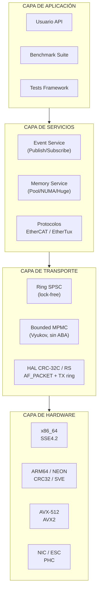
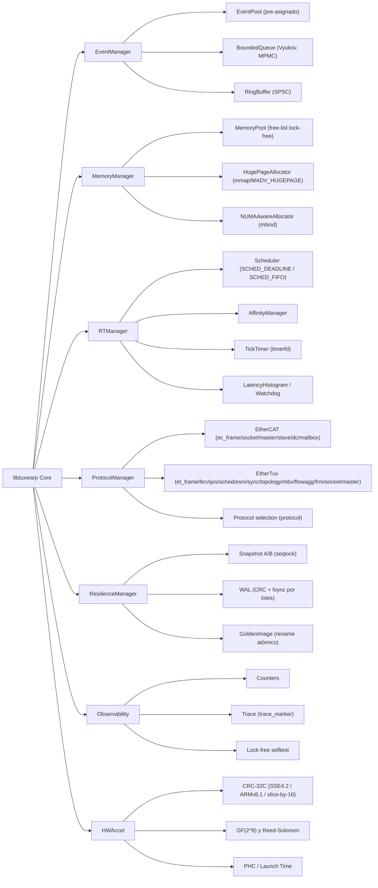
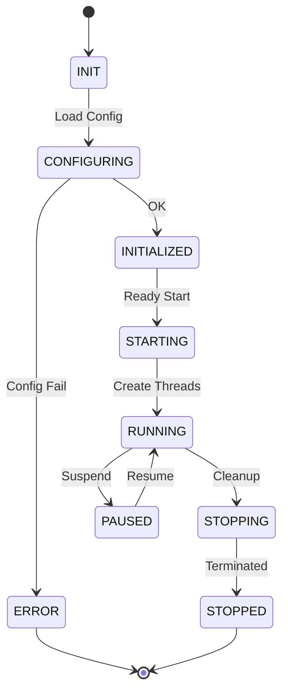
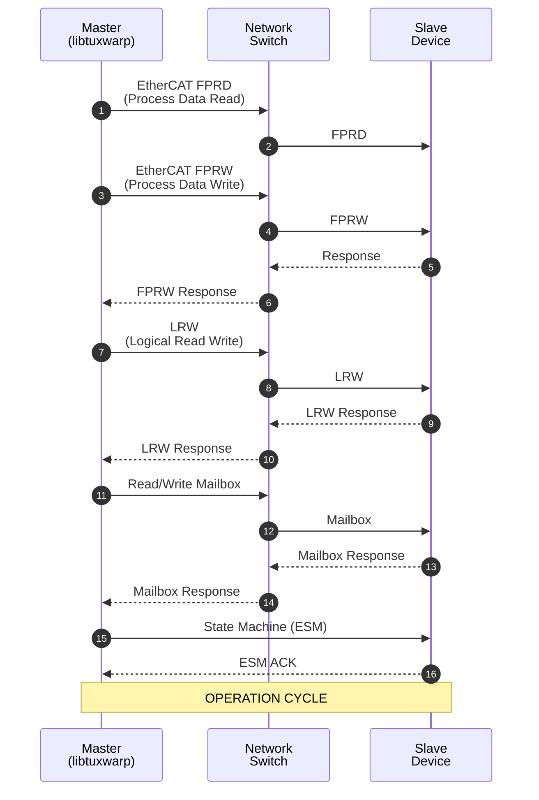
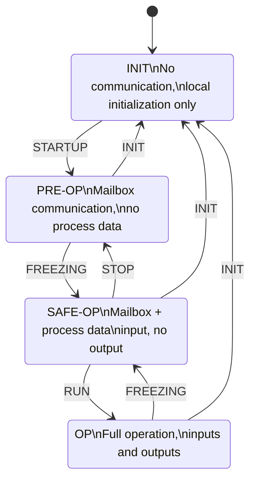
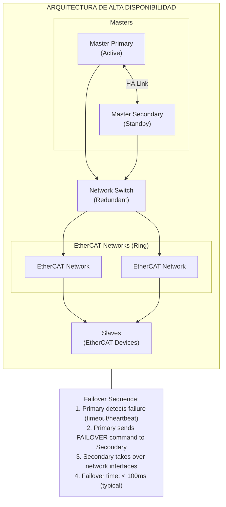
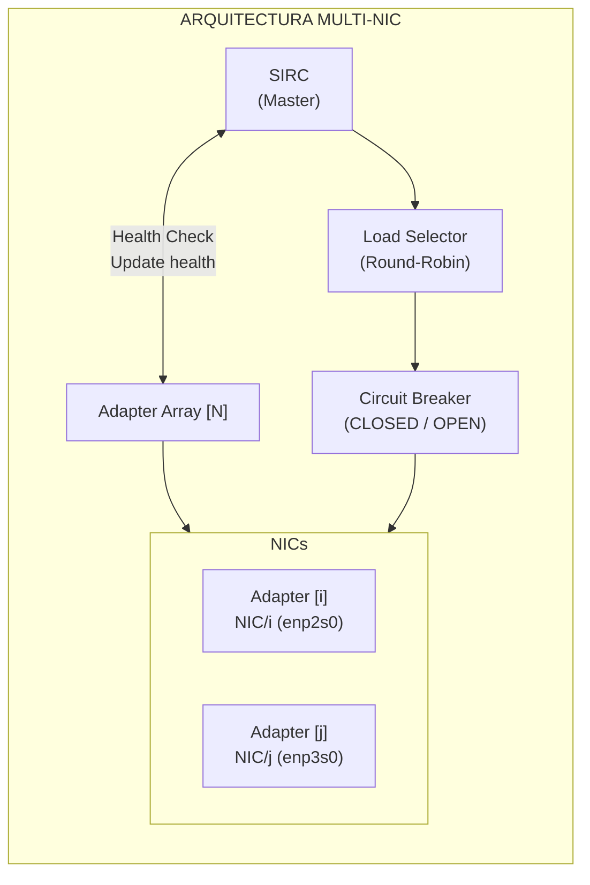

# Manual Técnico para Desarrollador - libtuxwarp

**Versión del Software:** 0.1.0
**Fecha:** Noviembre 2026

---

## Tabla de Contenidos

1. [Arquitectura del Sistema](#1-arquitectura-del-sistema)
2. [Protocolos de Comunicación](#2-protocolos-de-comunicación)
3. [Gestión de Esclavos](#3-gestión-de-esclavos)
4. [Configuración Avanzada de Comunicación](#4-configuración-avanzada-de-comunicación)
5. [API de Desarrollo](#5-api-de-desarrollo)
6. [Debugging y Logging](#6-debugging-y-logging)
7. [Actualización y Mantenimiento](#7-actualización-y-mantenimiento)
8. [Redundancia y Alta Disponibilidad](#8-redundancia-y-alta-disponibilidad)
9. [Análisis de Rendimiento y Optimización](#9-análisis-de-rendimiento-y-optimización)
10. [Seguridad y Cifrado](#10-seguridad-y-cifrado)
11. [Maestro EtherCAT de libtuxwarp](#11-maestro-ethercat-de-libtuxwarp)
12. [Librerías y Dependencias](#12-librerías-y-dependencias)
13. [EtherTux y HAL de aceleración por hardware](#13-ethertux-y-hal-de-aceleración-por-hardware)
14. [Soporte Multi-NIC](#14-soporte-multi-nic)
15. [Diagnóstico y Monitoreo](#15-diagnóstico-y-monitoreo)

---

## 1. Arquitectura del Sistema

### 1.1 Vista General de la Arquitectura

libtuxwarp implementa una arquitectura de capas con responsabilidades bien definidas:



### 1.2 Arquitectura de Componentes Internos

#### Diagrama de Componentes



### 1.3 Análisis de Complejidad Algorítmica

| Operación | Complejidad Temporal | Complejidad Espacial | Operaciones Atómicas |
|-----------|---------------------|---------------------|---------------------|
| `event_publish()` | O(1) | O(1) | 1 push a cola bounded |
| `event_subscribe()` | O(1) | O(1) | 1 pop de cola bounded |
| `ring_push()` | O(1) | O(1) | 1 store + 1 fetch_add |
| `ring_pop()` | O(1) | O(1) | 1 store + 1 fetch_sub |
| `bounded_push()` | O(1) | O(1) | 1 CAS |
| `bounded_pop()` | O(1) | O(1) | 1 CAS |
| `mem_pool_alloc()` | O(1) | O(1) | 1 pop de free-list |
| `mem_pool_free()` | O(1) | O(1) | 1 push a free-list |
| `aalid_candidate()` | O(1) | O(1) | CRC-32C de 6 B plegado (sin ramas) |
| `aalid_admit()` | O(1) amortizado | O(1) | Hash + cursor secuencial |
| `aalid_lookup()` | O(1) medio | O(1) | Tabla hash abierta |
| `aalid_release()` | O(slots) | O(1) | Recorrido de la tabla |

La cola Michael-Scott (`mpmc.h`) se conserva como referencia; su
`push`/`pop` asigna y libera nodos, por lo que **no** se usa en el camino
caliente (riesgo de ABA y `malloc` por operación).

### 1.4 Diagrama de Estados del Sistema



---

## 2. Protocolos de Comunicación

### 2.1 Protocolo de Eventos Internos

libtuxwarp utiliza un protocolo de eventos optimizado para mínima latencia:

```c
// Estructura de evento interno (64 bytes - cache line)
typedef struct CACHE_ALIGNED {
    volatile uint64_t sequence;        //  0-7:   Número de secuencia
    volatile uint64_t timestamp_ns;    //  8-15:  Timestamp de creación
    volatile uint32_t cpu_id;          // 16-19:  CPU que creó el evento
    volatile uint8_t  data[56];        // 20-63:  Payload (56 bytes)
} event_t;
```

La estructura **no** incluye prioridad ni tamaño explícito: el tamaño lo da la
llamada `event_publish(handle, data, size)` y se limita a 56 bytes.

### 2.2 Protocolo de Red (maestro EtherCAT)

libtuxwarp soporta **dos protocolos de red seleccionables** (nunca simultáneos sobre la
misma interfaz). El que se describe en este apartado es el **maestro EtherCAT** sobre Ethernet
crudo (`AF_PACKET`, EtherType **0x88A4**), conforme a IEC 61158 / ETG.1000. El otro, **EtherTux**
(EtherType **0x88B5**), se documenta en el apartado 13. La elección se resuelve en tiempo de
configuración mediante `protocol.h` (`PROTOCOL=ethercat|ethertux`).

**Trama EtherCAT:**

```c
typedef struct {                       // 14 B
    uint8_t  dst_mac[6];               // difusión FF:FF:FF:FF:FF:FF en el escaneo
    uint8_t  src_mac[6];               // MAC de la interfaz del maestro
    uint16_t ether_type;               // 0x88A4
} ec_eth_header_t;

/* Cabecera EtherCAT (2 B): longitud (11 bits) | tipo (4 bits = 1) */
typedef struct {                       // 2 B
    uint16_t length_type;              // (len & 0x07FF) | (1u << 12)
} ec_header_t;
```

**Datagrama EtherCAT** (tras la cabecera, todos los campos little-endian):

```c
typedef struct {                       // 10 B + datos + 2 B
    uint8_t  cmd;                      // comando (APRD, LRW, …)
    uint8_t  idx;                      // índice (para casar respuesta)
    uint16_t adp;                      // dirección de posición  } address =
    uint16_t ado;                      // dirección de offset    } adp | (ado<<16)
    uint16_t dlength;                  // 11 bits de longitud + bit M (0x8000)
    uint16_t irq;                      // interrupción (0)
    /* uint8_t data[dlength & 0x07FF]; */
    /* uint16_t wkc;                    // contador de trabajo */
} ec_datagram_t;
```

El **bit M** (`0x8000` del campo `dlength`) indica que siguen más datagramas en la misma trama.
El **contador de trabajo (WKC)** cuenta cuántas esclavas procesaron el datagrama; el maestro lo
valida frente al valor esperado para detectar pérdidas.

**Comandos soportados:** `NOP`, `APRD/APWR/APRW` (posición), `FPRD/FPWR/FPRW` (estación configurada),
`BRD/BWR/BRW` (difusión), `LRD/LWR/LRW` (lógico), `ARMW/FRMW` (lectura+escritura con máscara).

**API de serialización (pura y testeable sin hardware)** en `ethercat.h`:

```c
uint32_t ec_datagram_build(uint8_t* buf, uint32_t buf_len, uint8_t cmd,
                                     uint8_t idx, uint32_t address,
                                     const void* data, uint16_t data_len, bool more);
uint32_t ec_datagram_parse(const uint8_t* buf, uint32_t buf_len,
                                     ec_datagram_t* out);
uint16_t ec_frame_header(uint8_t out[2], uint16_t datagram_bytes);
```

### 2.3 Diagrama de Secuencia - Comunicación Maestro-Esclavo



### 2.4 Máquina de Estados EtherCAT (ESM)



---

## 3. Gestión de Esclavos

### 3.1 Estructura de Datos del Esclavo

```c
// Información del esclavo EtherCAT
typedef struct ec_slave {
    uint16_t vendor_id;            // Identificador del vendor
    uint16_t product_code;         // Código del producto
    uint32_t serial_number;        // Número de serie
    uint16_t alias;                // Alias (configurable)
    char     name[EC_MAXNAME];     // Nombre del dispositivo
    uint8_t  current_state;        // Estado actual ESM
    uint8_t  requested_state;      // Estado solicitado
    uint16_t alias_address;        // Dirección de alias

    // Información de Sync Managers
    struct {
        uint16_t start_address;    // Dirección inicial
        uint16_t length;           // Longitud
        uint8_t  control_register; // Registro de control
        uint8_t  status_register;  // Registro de estado
        bool     is_legal;         // Configuración válida
    } sync_managers[EC_MAXSM];

    // FMMU (Fieldbus Memory Management Unit)
    struct {
        uint32_t logical_address; // Dirección lógica
        uint8_t  length;          // Longitud en bytes
        uint8_t  start_bit;       // Bit inicial
        uint8_t  type;            // Tipo (input/output)
        bool     active;          // Activo
    } fmmus[EC_MAXFMMU];

    // PDO Mapping
    struct {
        uint16_t index;           // Índice de PDO
        uint8_t  subindex;        // Subíndice
        uint8_t  bit_length;      // Longitud en bits
        uint32_t entry;           // Entry completo
    } pdo_mapping[EC_MAXPDO];

    uint16_t pdo_count;           // Número de PDOs mapeados
    uint16_t eeprom_size;         // Tamaño de EEPROM

    // Timestamps
    uint64_t last_heartbeat_ns;   // Último heartbeat
    uint32_t error_count;         // Contador de errores
} ec_slave_t;
```

### 3.2 Procedimiento de Inicialización de Esclavo

```c
/**
 * Inicialización completa de un esclavo EtherCAT
 *
 * @param slave Puntero al esclavo a inicializar
 * @return código de error o 0 si éxito
 */
int ec_slave_init(ec_slave_t* slave) {
    // 1. Leer información del esclavo desde EEPROM
    int ret = ec_read_slave_identity(slave);
    if (ret != 0) {
        log_error("Failed to read slave identity: %d", ret);
        return ret;
    }

    // 2. Configurar direccionamiento
    ret = ec_configure_alias_address(slave, slave->alias);
    if (ret != 0) {
        log_error("Failed to configure alias: %d", ret);
        return ret;
    }

    // 3. Inicializar Mailbox
    ret = ec_init_mailbox(slave);
    if (ret != 0) {
        log_error("Mailbox init failed: %d", ret);
        return ret;
    }

    // 4. Configurar SM (Sync Managers)
    ret = ec_configure_sync_managers(slave);
    if (ret != 0) {
        log_error("SM configuration failed: %d", ret);
        return ret;
    }

    // 5. Mapear PDOs
    ret = ec_map_pdos(slave);
    if (ret != 0) {
        log_error("PDO mapping failed: %d", ret);
        return ret;
    }

    // 6. Configurar FMMUs
    ret = ec_configure_fmmus(slave);
    if (ret != 0) {
        log_error("FMMU configuration failed: %d", ret);
        return ret;
    }

    // 7. Solicitar estado SAFE-OP
    ret = ec_set_state(slave, EC_STATE_SAFE_OP);
    if (ret != 0) {
        log_error("Failed to set SAFE-OP: %d", ret);
        return ret;
    }

    // 8. Verificar estado
    ret = ec_verify_state(slave, EC_STATE_SAFE_OP, 1000); // 1s timeout
    if (ret != 0) {
        log_error("State verification failed: %d", ret);
        return ret;
    }

    return 0;
}
```

### 3.3 Monitoreo de Esclavos

```c
// Estructura para monitoreo de estado
typedef struct {
    uint16_t slave_index;
    uint64_t last_update_ns;
    uint32_t error_count;
    uint8_t  state;
    uint16_t wkc;                  // Working Counter
    uint64_t latency_min_ns;
    uint64_t latency_max_ns;
    uint64_t latency_avg_ns;
} slave_monitor_t;

// Hilo de monitoreo de esclavos
void* slave_monitor_thread(void* arg) {
    handle_t handle = (handle_t)arg;

    while (g_running) {
        for (int i = 0; i < g_slave_count; i++) {
            uint64_t start = get_timestamp_ns();

            // Enviar FRMW (Force Read Multiple Words)
            int wkc = ec_send_frdw(g_slave_list[i].station_address);

            uint64_t end = get_timestamp_ns();
            uint64_t latency = end - start;

            // Actualizar métricas
            update_slave_metrics(i, wkc, latency);
        }

        // Reportar estado cada segundo
        report_slave_status();

        usleep(1000);  // 1ms ciclo
    }

    return NULL;
}

// Actualización de métricas
void update_slave_metrics(int slave_idx, int wkc, uint64_t latency) {
    slave_monitor_t* mon = &g_slave_monitors[slave_idx];

    mon->last_update_ns = get_timestamp_ns();
    mon->wkc = wkc;

    if (wkc == 0) {
        mon->error_count++;
        log_warning("Slave %d: WKC=0 (communication error)", slave_idx);
    }

    // Actualizar latencia
    if (latency < mon->latency_min_ns) mon->latency_min_ns = latency;
    if (latency > mon->latency_max_ns) mon->latency_max_ns = latency;

    // Calcular promedio móvil
    mon->latency_avg_ns = (mon->latency_avg_ns * 7 + latency) / 8;
}
```

### 3.4 Detección y Recuperación de Errores

```c
// Códigos de error de esclavo
typedef enum {
    EC_SLAVE_OK             = 0,
    EC_SLAVE_ERROR_COMMS    = 1,    // Error de comunicación
    EC_SLAVE_ERROR_TIMEOUT  = 2,    // Timeout de respuesta
    EC_SLAVE_ERROR_STATE    = 3,    // Estado incorrecto
    EC_SLAVE_ERROR_WKC      = 4,    // Working Counter inválido
    EC_SLAVE_ERROR_SYNC     = 5,    // Error de sincronización
    EC_SLAVE_ERROR_FMMU     = 6,    // Error FMMU
    EC_SLAVE_ERROR_PDO      = 7,    // Error de PDO mapping
    EC_SLAVE_ERROR_CONFIG   = 8     // Configuración inválida
} ec_slave_error_t;

// Procedimiento de recuperación
int ec_recover_slave(ec_slave_t* slave) {
    log_info("Attempting recovery of slave %s", slave->name);

    // 1. Contador de intentos
    static int recovery_attempts[EC_MAXSLAVE] = {0};

    if (recovery_attempts[slave->index] > 3) {
        log_error("Max recovery attempts reached for slave %d", slave->index);
        recovery_attempts[slave->index] = 0;
        return -1;
    }

    // 2. Intentar transition a INIT
    int ret = ec_set_state(slave, EC_STATE_INIT);
    if (ret != 0) {
        log_error("Failed to set INIT state: %d", ret);
        recovery_attempts[slave->index]++;
        return ret;
    }

    usleep(100000);  // 100ms espera

    // 3. Re-inicializar
    ret = ec_slave_init(slave);
    if (ret != 0) {
        log_error("Re-initialization failed: %d", ret);
        recovery_attempts[slave->index]++;
        return ret;
    }

    // 4. Volver a Safe-Op
    ret = ec_set_state(slave, EC_STATE_SAFE_OP);
    if (ret != 0) {
        log_error("Failed to return to SAFE-OP: %d", ret);
        recovery_attempts[slave->index]++;
        return ret;
    }

    recovery_attempts[slave->index] = 0;
    log_info("Slave %s recovered successfully", slave->name);

    return 0;
}
```

---

## 4. Configuración Avanzada de Comunicación

### 4.1 Parámetros de Comunicación

```c
// Estructura de configuración avanzada de red
typedef struct {
    // Timeouts (en microsegundos)
    uint32_t timeout_init;         // Timeout inicialización
    uint32_t timeout_cycle;        // Timeout de ciclo
    uint32_t timeout_mailbox;      // Timeout mailbox
    uint32_t timeout_peer;         // Timeout de peer

    // Sizes
    uint16_t max_slaves;           // Máximo de esclavos
    uint16_t max_mbx_size;         // Tamaño máximo de mailbox
    uint16_t max_pdo_size;         // Tamaño máximo de PDO

    // Performance
    uint8_t  cycle_interval_ns;    // Intervalo de ciclo en ns
    uint8_t  retries;              // Número de reintentos
    bool     use_watchdog;         // Habilitar watchdog
    uint16_t watchdog_interval_ms; // Intervalo de watchdog

    // Advanced
    bool     use_dc;               // Distributed Clock
    uint32_t dc_cycle_ns;          // Ciclo DC en ns
    uint32_t dc_sync0_offset_ns;   // Offset SYNC0
    uint32_t dc_sync1_offset_ns;   // Offset SYNC1
} ec_com_config_t;
```

### 4.2 Configuración de Distributed Clocks

```c
// Configuración de Distributed Clocks (DC)
int ec_configure_dc(ec_slave_t* slave, uint32_t cycle_ns) {
    // 1. Leer capacidad DC del esclavo
    uint32_t capabilities = ec_read_dc_capabilities(slave);
    if (!(capabilities & EC_DC_SUPPORTED)) {
        log_warning("Slave %s does not support DC", slave->name);
        return -1;
    }

    // 2. Configurar tiempo de ciclo
    int ret = ec_write_dc_cycle_time(slave, cycle_ns);
    if (ret != 0) return ret;

    // 3. Configurar offsets
    ret = ec_write_dc_sync0_time(slave, 0);  // SYNC0 al inicio del ciclo
    if (ret != 0) return ret;

    ret = ec_write_dc_sync1_time(slave, cycle_ns / 2);  // SYNC1 a mitad
    if (ret != 0) return ret;

    // 4. Habilitar DC
    ret = ec_write_dc_control(slave, EC_DC_ENABLE);
    if (ret != 0) return ret;

    // 5. Sincronizar con maestro
    ret = ec_dc_sync(slave, 1000000);  // 1ms timeout
    if (ret != 0) return ret;

    log_info("DC configured for %s: cycle=%dns", slave->name, cycle_ns);
    return 0;
}

// Algoritmo de sincronización DC
int ec_dc_sync(ec_slave_t* slave, uint32_t timeout_us) {
    uint64_t start_ns = get_timestamp_ns();
    uint64_t target_time;
    int64_t offset;

    // 1. Obtener tiempo actual del maestro
    uint64_t master_time = get_master_time_ns();

    // 2. Leer tiempo del esclavo
    uint64_t slave_time = ec_read_dc_time(slave);

    // 3. Calcular offset
    offset = (int64_t)slave_time - (int64_t)master_time;

    // 4. Aplicar corrección
    if (offset > EC_DC_MAX_OFFSET) {
        // Ajuste grande - puede causar glitch
        ec_write_dc_time(slave, master_time);
        log_warning("Large DC offset correction: %lld ns", offset);
    } else if (offset > EC_DC_SMALL_OFFSET) {
        // Ajuste gradual
        uint32_t correction = (uint32_t)(offset / 2);
        ec_write_dc_time_offset(slave, correction);
    }

    // 5. Esperar y verificar
    usleep(100);  // 100us para que tome efecto

    uint64_t verify_time = ec_read_dc_time(slave);
    uint64_t new_offset = (verify_time > master_time) ?
        verify_time - master_time : master_time - verify_time;

    if (new_offset > EC_DC_MAX_OFFSET) {
        log_error("DC sync failed: offset=%llu", new_offset);
        return -1;
    }

    log_debug("DC sync complete: offset=%lld ns", (int64_t)new_offset);
    return 0;
}
```

### 4.3 Configuración de PDOs

```c
// Mapeo de PDO dinámico
int ec_configure_pdo_mapping(ec_slave_t* slave,
                              uint16_t pdo_index,
                              ec_pdo_entry_t* entries,
                              int entry_count) {

    // 1. Buscar PDO por índice
    ec_pdo_t* pdo = ec_find_pdo(slave, pdo_index);
    if (!pdo) {
        log_error("PDO 0x%04X not found", pdo_index);
        return -1;
    }

    // 2. Validar entradas
    uint16_t total_bits = 0;
    for (int i = 0; i < entry_count; i++) {
        if (entries[i].bit_length == 0 || entries[i].bit_length > 64) {
            log_error("Invalid bit length for entry %d", i);
            return -1;
        }
        total_bits += entries[i].bit_length;
    }

    if (total_bits > 64) {
        log_error("PDO mapping exceeds 64 bits: %d", total_bits);
        return -1;
    }

    // 3. Configurar entradas
    for (int i = 0; i < entry_count; i++) {
        int ret = ec_pdo_add_entry(pdo,
                                    entries[i].index,
                                    entries[i].subindex,
                                    entries[i].bit_length);
        if (ret != 0) {
            log_error("Failed to add PDO entry 0x%04X/%d",
                     entries[i].index, entries[i].subindex);
            return ret;
        }
    }

    // 4. Activar PDO
    return ec_pdo_activate(pdo);
}

// Estructura de entrada PDO
typedef struct {
    uint16_t index;       // Índice de objeto
    uint8_t  subindex;    // Subíndice
    uint8_t  bit_length;   // Longitud en bits
    void*    data_ptr;     // Puntero a datos
} ec_pdo_entry_t;
```

---

## 5. API de Desarrollo

### 5.1 API Completa de Eventos

```c
/**
 * Inicialización del sistema libtuxwarp
 *
 * @param handle Puntero al handle de salida
 * @param config Configuración del sistema
 * @return SUCCESS o código de error
 */
status_t init(handle_t* handle,
                                   const config_t* config);

/**
 * Cierre del sistema
 *
 * @param handle Handle de libtuxwarp
 * @return SUCCESS o código de error
 */
status_t shutdown(handle_t handle);

/**
 * Publicar un evento
 *
 * @param handle Handle de libtuxwarp
 * @param data Puntero a datos del evento
 * @param size Tamaño de datos (máx 56 bytes)
 * @return SUCCESS o código de error
 */
status_t event_publish(handle_t handle,
                                            const void* data,
                                            uint32_t size);

/**
 * Suscribirse a un evento
 *
 * @param handle Handle de libtuxwarp
 * @param event Evento de salida
 * @param timeout_us Timeout en microsegundos
 * @return SUCCESS, TIMEOUT, o código de error
 */
status_t event_subscribe(handle_t handle,
                                              event_t* event,
                                              uint32_t timeout_us);

/**
 * Ejecutar un benchmark bajo demanda
 *
 * @param handle Handle de libtuxwarp
 * @param mode Modo (LATENCY, THROUGHPUT, JITTER, STRESS, WCET)
 * @param duration_sec Duración en segundos
 * @param metrics Estructura de métricas de salida
 * @return SUCCESS o código de error
 */
status_t benchmark_run(handle_t handle,
                                           benchmark_mode_t mode,
                                           uint32_t duration_sec,
                                           metrics_t* metrics);

/** Imprime un reporte formateado de las métricas. */
status_t metrics_report(const metrics_t* metrics);

/** Contador de ciclos y timestamp monotónico. */
uint64_t get_cycles(void);
uint64_t get_timestamp_ns(void);
```

### 5.2 Ejemplo de Uso de la API

```c
#include <libtuxwarp/libtuxwarp.h>
#include <stdio.h>
#include <signal.h>

static volatile bool g_running = true;

void signal_handler(int sig) {
    (void)sig;
    g_running = false;
}

int main(int argc, char* argv[]) {
    (void)argc; (void)argv;

    // Configurar handler de señales
    signal(SIGINT, signal_handler);
    signal(SIGTERM, signal_handler);

    // Configuración del sistema
    config_t config = {
        .event_pool_size = 65536,
        .batch_size = 256,
        .use_simd = true,
        .use_cpu_affinity = true,
        .use_hugepages = false,
        .platform = PLATFORM_RPI4
    };

    // Inicializar libtuxwarp
    handle_t handle;
    status_t status = init(&handle, &config);
    if (status != SUCCESS) {
        fprintf(stderr, "Failed to initialize: %d\n", status);
        return 1;
    }

    printf("libtuxwarp initialized successfully\n");

    // Datos de ejemplo
    typedef struct {
        float position;
        float velocity;
        uint32_t timestamp;
    } control_data_t;

    control_data_t data = {0};
    uint64_t iteration = 0;

    // Loop principal
    while (g_running) {
        // Leer datos de sensores (simulado)
        data.position = (float)(iteration % 1000) / 10.0f;
        data.velocity = (float)((iteration % 100) / 10.0f);
        data.timestamp = (uint32_t)get_timestamp_ns();

        // Publicar evento
        status = event_publish(handle, &data, sizeof(data));
        if (status != SUCCESS) {
            fprintf(stderr, "Publish failed: %d\n", status);
        }

        iteration++;

        // Simular control a 1 kHz.
        // En producción use tick_wait() (timerfd) y SCHED_DEADLINE.
        usleep(1000);  // 1 ms = 1000 us
    }

    // Benchmark de WCET bajo demanda (no hay "get_metrics" en runtime)
    metrics_t metrics;
    if (benchmark_run(handle, MODE_WCET, 1u, &metrics) ==
        SUCCESS) {
        metrics_report(&metrics);
    }

    // Apagar
    shutdown(handle);
    printf("libtuxwarp shut down\n");

    return 0;
}
```

### 5.3 API de planificación, memoria y tiempo real

```c
/* sched.h — SCHED_DEADLINE / SCHED_FIFO / afinidad / aislamiento */
bool               sched_deadline_supported(void);
status_t sched_set_deadline_current(const deadline_attr_t* attr);
status_t sched_set_fifo_current(int priority);
status_t sched_set_affinity_current(int cpu);
status_t sched_isolation_probe(isolation_t* out);
bool               sched_cpu_is_isolated(const isolation_t* iso, int cpu);
void               sched_isolation_print(const isolation_t* iso);
int                sched_online_cpus(void);

/* mem.h — bloqueo de memoria, hugepages y NUMA */
status_t mem_lock_all(void);
void               mem_unlock_all(void);
size_t             mem_hugepage_size(void);
int                mem_current_numa_node(void);
int                mem_numa_nodes(void);

/* rt.h — tick periódico, watchdog e histograma */
status_t tick_init(tick_t* tick, uint64_t period_ns);
int                tick_wait(tick_t* tick);
void               tick_destroy(tick_t* tick);

status_t watchdog_init(watchdog_t* wd, uint64_t timeout_ns);
void               watchdog_kick(watchdog_t* wd);
bool               watchdog_expired(const watchdog_t* wd);
bool               watchdog_hw_available(void);

void               hist_init(hist_t* h, uint64_t bucket_ns);
void               hist_record(hist_t* h, uint64_t latency_ns);
uint64_t           hist_percentile_ns(const hist_t* h, double p);
uint64_t           hist_wcet_ns(const hist_t* h);

/* kernel.h — sondeo del kernel */
status_t kernel_probe(kernel_info_t* info);
void               kernel_print(const kernel_info_t* info);
bool               kernel_is_supported(const kernel_info_t* info);
```

### 5.4 API de resiliencia y observabilidad

```c
/* resilience.h */
status_t snapshot_init(snapshot_t* s, uint32_t size);
status_t snapshot_write(snapshot_t* s, const void* data, uint32_t size);
status_t snapshot_read(const snapshot_t* s, void* out, uint32_t size);

status_t wal_open(wal_t* w, const char* path, uint32_t batch);
status_t wal_append(wal_t* w, const void* rec, uint32_t len);
status_t wal_sync(wal_t* w);
int                wal_replay(const char* path,
                                        int (*cb)(const void* rec, uint32_t len, void* ud),
                                        void* ud);

status_t golden_save(const char* path, const void* data, uint32_t len);
status_t golden_load(const char* path, void* out, uint32_t cap, uint32_t* out_len);

/* obs.h */
void               counters_init(counters_t* c);
void               counters_print(const counters_t* c, const char* label);
status_t trace_init(trace_t* t);
int                trace_mark(trace_t* t, const char* msg);
status_t selftest_bounded_queue(uint32_t producers, uint32_t consumers,
                                                    uint64_t total,
                                                    lockfree_stats_t* out);
```

> **No existe** una API de reconfiguración en caliente (`reconfigure`) ni
> de logging/callbacks globales. La configuración se fija en `init`;
> para cambiar parámetros de red en caliente use `et_master_set_qos`,
> `set_fec` y `set_tx_mode`.

---

## 6. Debugging y Logging

### 6.1 Observabilidad y logging

libtuxwarp **no impone un sistema de logging global**. Para diagnóstico ofrece
tres mecanismos de bajo coste:

```c
#include <libtuxwarp/obs.h>

/* 1. Contadores atómicos consultables en vivo. */
counters_t counters;
counters_init(&counters);
counters_print(&counters, "rx");
/* published, consumed, dropped, errors, forwarded */

/* 2. Traza de baja sobrecarga (trace_marker de ftrace, best-effort). */
trace_t trace;
if (trace_init(&trace) == SUCCESS) {
    trace_mark(&trace, "cycle-start");
    /* ... */
    trace_destroy(&trace);
}

/* 3. Autotest de colas lock-free (pérdidas/duplicados). */
lockfree_stats_t lf;
selftest_bounded_queue(2u, 2u, 100000u, &lf);
```

Para mensajes de aplicación use `fprintf(stderr, ...)` o su propio logger; el
kernel ya aporta timestamps y la traza de ftrace. El detector de kernel imprime
su estado con `kernel_print()` al inicializar.

### 6.2 Debugging con GDB

```bash
# Compilar con symbols de debug
cmake .. -DCMAKE_BUILD_TYPE=Debug
make

# Ejecutar con GDB
gdb ./build/bench

# Comandos útiles de GDB
(gdb) break event_publish
(gdb) break event_subscribe
(gdb) run --mode=latency --duration=10

# Ver backtrace al llegar a breakpoint
(gdb) bt

# Examinar variables
(gdb) p handle
(gdb) p *event

# Ver registros de CPU
(gdb) info registers

# Ver estado de threads
(gdb) info threads

# Cambiar a thread específico
(gdb) thread 2
```

### 6.3 Análisis con perf

```bash
# Perfilado básico
perf stat -B -e cycles,instructions,cache-references,cache-misses ./bench --mode=latency

# Perfilado con overhead
perf record -g ./bench --mode=latency --duration=30
perf report --stdio

# Flame graph
perf record -F 99 -g ./bench --mode=latency --duration=60
perf script | stackcollapse-perf.pl | flamegraph.pl > latency.svg

# Analizar caché
perf stat -e cache-misses,cache-references, LLC-misses ./bench --mode=throughput
```

---

## 7. Actualización y Mantenimiento

### 7.1 Procedimiento de Actualización

```bash
#!/bin/bash
# update_libtuxwarp.sh

set -e

NEW_VERSION="1.1.0"
BACKUP_DIR="/var/backups/libtuxwarp"
INSTALL_DIR="/opt/libtuxwarp"

echo "libtuxwarp Update Script v$NEW_VERSION"
echo "======================================="

# 1. Detener servicio actual
echo "[1/7] Stopping current service..."
sudo systemctl stop libtuxwarp || true

# 2. Crear respaldo
echo "[2/7] Creating backup..."
mkdir -p "$BACKUP_DIR"
sudo cp -r "$INSTALL_DIR" "$BACKUP_DIR/$(date +%Y%m%d_%H%M%S)"

# 3. Descargar nueva versión
echo "[3/7] Downloading new version..."
wget -O /tmp/libtuxwarp-$NEW_VERSION.tar.gz "https://example.com/libtuxwarp-$NEW_VERSION.tar.gz"

# 4. Verificar checksum
echo "[4/7] Verifying checksum..."
sha256sum /tmp/libtuxwarp-$NEW_VERSION.tar.gz

# 5. Extraer e instalar
echo "[5/7] Extracting and installing..."
cd /tmp
tar -xzf libtuxwarp-$NEW_VERSION.tar.gz
cd libtuxwarp-$NEW_VERSION
mkdir -p build && cd build
cmake .. -DCMAKE_BUILD_TYPE=RelWithDebInfo
make -j$(nproc)
sudo make install

# 6. Reiniciar servicio
echo "[6/7] Restarting service..."
sudo systemctl daemon-reload
sudo systemctl start libtuxwarp

# 7. Verificar
echo "[7/7] Verifying installation..."
/opt/libtuxwarp/bin/test

echo "Update complete!"
```

### 7.2 Script de Mantenimiento Preventivo

```bash
#!/bin/bash
# maintenance.sh - Script de mantenimiento mensual

LOG_FILE="/var/log/maintenance.log"

log() {
    echo "[$(date '+%Y-%m-%d %H:%M:%S')] $1" | tee -a "$LOG_FILE"
}

log "Starting monthly maintenance"

# 1. Verificar espacio en disco
log "[1/6] Checking disk space..."
df -h / | tail -1 | awk '{print "Disk usage: " $5}'

# 2. Rotar logs antiguos
log "[2/6] Rotating old logs..."
find /var/log/libtuxwarp -name "*.log" -mtime +30 -exec gzip {} \;
find /var/log/libtuxwarp -name "*.gz" -mtime +90 -delete

# 3. Verificar integridad de biblioteca
log "[3/6] Verifying library integrity..."
ldd /usr/local/lib/liblibtuxwarp.so

# 4. Verificar configuración
log "[4/6] Checking configuration..."
/opt/libtuxwarp/bin/test --validate-config

# 5. Correr tests
log "[5/6] Running tests..."
/opt/libtuxwarp/bin/test || log "WARNING: Some tests failed"

# 6. Reporte de métricas
log "[6/6] Collecting metrics..."
/opt/libtuxwarp/bin/bench --mode=latency --duration=30 > /var/log/metrics_$(date +%Y%m%d).log

log "Maintenance complete"
```

---

## 8. Redundancia y Alta Disponibilidad

### 8.1 Arquitectura de Redundancia



### 8.2 Implementación de Redundancia

```c
// Estado del sistema HA
typedef enum {
    HA_STATE_INIT,
    HA_STATE_STANDBY,
    HA_STATE_ACTIVE,
    HA_STATE_FAILING_OVER,
    HA_STATE_FAILED
} ha_state_t;

// Estructura HA
typedef struct {
    ha_state_t state;
    uint8_t    priority;          // 0-255, mayor = preferido
    uint32_t   heartbeat_interval; // ms
    uint32_t   heartbeat_timeout;  // ms
    uint64_t   last_heartbeat_ns;
    int        socket_fd;
    struct     sockaddr_in peer_addr;
} ha_context_t;

// Hilo de heartbeat
void* ha_heartbeat_thread(void* arg) {
    ha_context_t* ctx = (ha_context_t*)arg;
    uint8_t msg[HA_MSG_SIZE];

    while (ctx->state != HA_STATE_FAILED) {
        // Enviar heartbeat
        msg[0] = HA_MSG_HEARTBEAT;
        msg[1] = ctx->priority;
        *(uint64_t*)(msg + 2) = get_timestamp_ns();

        sendto(ctx->socket_fd, msg, sizeof(msg), 0,
               (struct sockaddr*)&ctx->peer_addr, sizeof(ctx->peer_addr));

        usleep(ctx->heartbeat_interval * 1000);
    }

    return NULL;
}

// Manejo de failover
void handle_failover(ha_context_t* ctx) {
    log_warning("Initiating failover");
    ctx->state = HA_STATE_ACTIVE;
    log_info("Failover complete, now active");
}
```

---

## 9. Análisis de Rendimiento y Optimización

### 9.1 Análisis WCET

libtuxwarp **no publica una suma teórica de WCET**: la cota útil es la que se
mide en el hardware y kernel reales. Para ello usa el histograma de
`rt.h`:

```c
#include <libtuxwarp/rt.h>

hist_t hist;
hist_init(&hist, 100);            /* buckets de 100 ns */

while (running) {
    uint64_t t0 = get_timestamp_ns();
    /* ... trabajo del ciclo ... */
    uint64_t t1 = get_timestamp_ns();
    hist_record(&hist, t1 - t0);
}

uint64_t wcet   = hist_wcet_ns(&hist);
uint64_t p999   = hist_percentile_ns(&hist, 99.9);
uint64_t sigma  = hist_stddev_ns(&hist);
uint64_t mean   = hist_mean_ns(&hist);

hist_print(&hist, "ciclo de control");
```

`hist_print()` publica media, desviación, percentiles y WCET de la
ventana medida. Repita la medición en cada plataforma: el resultado depende de
PREEMPT_RT, `isolcpus`, *governor*, C-states y de la NIC.

### 9.2 Optimización de Cache

```c
// Análisis de cache misses
typedef struct {
    uint64_t l1_misses;
    uint64_t l2_misses;
    uint64_t l3_misses;
    uint64_t total_accesses;
} cache_stats_t;

// Optimización: Prefetch de datos
void optimized_process_batch(event_batch_t* batch) {
    for (int i = 0; i < batch->count; i++) {
        process_event(&batch->events[i]);

        if (i + 1 < batch->count) {
            __builtin_prefetch(&batch->events[i + 1], 0, 3);
        }

        if (batch->events[i].data_ptr) {
            __builtin_prefetch(batch->events[i].data_ptr, 0, 0);
        }
    }
}
```

### 9.3 ID local determinista (EtherTux)

Identidad de 16 bits en una MAC LAA (`02:00:00:00:ID[15:8]:ID[7:0]`) con dos
niveles: el receptor deriva el ID candidato de la MAC (CRC-32C plegado) y el
maestro resuelve las colisiones con un cursor secuencial determinista solo en
admisión. El coste del camino crítico es de tiempo constante:

| Operación | Coste medido | Notas |
|---|---:|---|
| ID candidato (CRC-32C plegado) | 5,2 ns | sin ramas ni bucles |
| `ID → MAC` / `MAC → ID` | 0,15 / 0,8 ns | identidad en el cable |
| Filtro de destino del maestro | 6,2 ns | descarta antes de parsear |
| Admisión (nodo nuevo) | 62 ns | O(1) amortizado, fuera del superframe |
| Búsqueda `{MAC → ID}` | 15,4 ns | tabla hash abierta |

Con el ID activo, la recepción descarta las tramas unicast ajenas
(`local_id_dropped`), los nodos se indexan por hash de MAC y el maestro puede
emitir unicast con `send_to()` en lugar de difusión, lo que evita el *flooding*
del switch. La tabla `{MAC → ID}` se persiste con reemplazo atómico.

**Flujo de admisión (`et_aalid_admit`):**

1. Se calcula el ID candidato (CRC-32C de la MAC plegado) y se indexa la tabla.
2. Si la MAC ya está registrada con el mismo `nonce`, se refresca su
   `last_hb_ms` y se devuelve el ID existente (`DUPLICATE`); si el `nonce`
   difiere, se rechaza como MAC clonada (`CLONE`, `ERROR_STATE`).
3. Si el candidato está libre en el bitmap, se asigna (`OK`). Si está ocupado,
   `et_aalid_find_free` busca el primer hueco desde `next_free_hint` y en
   envolvente (`COLLISION`).
4. Se inserta en la primera ranura libre o *tombstone* de la cadena de sondeo,
   se marca el bit y se avanza el cursor. Sin hueco, `FULL`.
5. `expire` libera los IDs sin heartbeat dentro de `grace_ms` (10 min por
   defecto) y deja *tombstones* reutilizables.

Memoria: ≈ 14,4 KB con los valores por defecto (tabla de 256 ranuras × 24 B y
bitmap de 8 KB). Persistencia: cabecera de 16 B (`ETID`, versión 1, número de
entradas) y 24 B por entrada (MAC, ID, `nonce`, `last_hb_ms`), con escritura
`tmp` + `rename`.

---

## 10. Seguridad y Cifrado

### 10.1 Alcance real

libtuxwarp **no implementa cifrado, autenticación ni control de acceso**. Es una
biblioteca de transporte y tiempo real; la seguridad se delega en el despliegue:

| Capa | Responsabilidad | Herramienta |
|---|---|---|
| Aislamiento físico/lógico | Red exclusiva para EtherCAT/EtherTux | VLAN, switch dedicado, `macvlan` |
| Permisos | Solo el proceso RT abre `AF_PACKET` | `CAP_NET_RAW`, usuario dedicado |
| Filtrado | Listas de MAC/ puertos en el switch | Configuración del switch |
| Integridad | CRC-32C por trama (EtherTux) y WKC (EtherCAT) | Ya implementado, **no es criptográfico** |
| Confidencialidad | Opcional en el plano de gestión | Motor criptográfico del SoC, **fuera del camino crítico** |

> El CRC-32C detecta corrupción accidental, **no** autentica ni cifra. No use
> EtherTux sobre una red no confiable sin una capa externa (IPsec, MACsec o
> aislamiento físico).

### 10.2 Motores criptográficos del SoC

La HAL **detecta** `armv8_crypto` (AES/SHA) y reporta el motor del SoC, pero no
lo usa en el datapath. Los motores dedicados (`sun8i-ce`, `rk_crypto`) solo se
contemplan para cifrado opcional del plano de gestión; `rk2_crypto` aún está en
parcheo y no debe usarse en producción.

### 10.3 Recomendaciones

1. Red física o VLAN exclusiva para el bus de control.
2. Ejecutar el proceso RT con `CAP_NET_RAW` y sin privilegios adicionales.
3. Fijar MACs de esclavas/nodos y revisar `frames_lost`, WKC y ET-WKC.
4. Si se requiere confidencialidad, aplicarla **fuera** del ciclo crítico
   (gateway, IPsec/MACsec o cifrado a nivel de aplicación en P4/P5).

---

## 11. Maestro EtherCAT de libtuxwarp

### 11.1 Visión general

libtuxwarp incorpora un **maestro EtherCAT autónomo** implementado íntegramente en C11
sobre Ethernet crudo (`AF_PACKET`, EtherType **0x88A4**), conforme a IEC 61158 / ETG.1000.

Es uno de los **dos backends de red** del sistema (el otro es EtherTux, apartado 13). No existe
transporte RAW ni conmutación de protocolo en caliente: el backend se elige al configurar.
Cualquier aplicación puede enumerar las interfaces del sistema, abrir una de ellas como maestro
EtherCAT y comunicarse con las esclavas mediante la API pública `ethercat.h`.

Diseño guiado por los cuatro pilares del proyecto:

| Pilar | Cómo se materializa |
|---|---|
| **Tiempo real** | cero asignaciones dinámicas en el camino caliente: tramas y mapa de proceso (`IOMap`) pre-asignados; el ciclo de proceso no reserva memoria ni bloquea. |
| **Determinismo** | temporización con `CLOCK_MONOTONIC`, *timeouts* acotados y `poll()` con vencimiento absoluto; no hay esperas indefinidas. |
| **Resiliencia absoluta** | validación por contador de trabajo (WKC), detección de esclavas perdidas, contadores de error del ESC, reintentos acotados, ACK de errores AL y redundancia de red (doble NIC). |
| **Ultra rendimiento** | varios datagramas por trama (bit **M**), `PACKET_QDISC_BYPASS`, prioridad de socket elevada y cero copias superfluas. |

> **Sin dependencias externas.** A diferencia de SOEM o del maestro IgH, este maestro no enlaza
> ninguna biblioteca de terceros: habla directamente con la NIC a través del socket de paquetes
> del kernel y serializa el protocolo EtherCAT en espacio de usuario.

### 11.2 Arquitectura modular

El maestro está dividido en seis módulos con responsabilidad única
(`src/protocols/ethercat/`), más una cabecera interna compartida:

| Módulo | Responsabilidad |
|---|---|
| [`ec_internal.h`](file:///mnt/netac/MI_MUNDO/PROYECTOS/KLIPPER/PROYECTOS/libtuxwarp/src/protocols/ethercat/ec_internal.h) | Geometría de trama, registros ESC, *structs* internas y prototipos compartidos. |
| [`ec_frame.c`](file:///mnt/netac/MI_MUNDO/PROYECTOS/KLIPPER/PROYECTOS/libtuxwarp/src/protocols/ethercat/ec_frame.c) | Serialización/parseo puro de datagramas y tramas (testeable sin hardware). |
| [`ec_socket.c`](file:///mnt/netac/MI_MUNDO/PROYECTOS/KLIPPER/PROYECTOS/libtuxwarp/src/protocols/ethercat/ec_socket.c) | Socket `AF_PACKET` de tiempo real, redundancia doble NIC y enumeración de interfaces. |
| [`ec_master.c`](file:///mnt/netac/MI_MUNDO/PROYECTOS/KLIPPER/PROYECTOS/libtuxwarp/src/protocols/ethercat/ec_master.c) | Ciclo de vida, intercambio de datagramas y ciclo de datos de proceso (PDO). |
| [`ec_slave.c`](file:///mnt/netac/MI_MUNDO/PROYECTOS/KLIPPER/PROYECTOS/libtuxwarp/src/protocols/ethercat/ec_slave.c) | Escaneo del bus, SII/EEPROM, Sync Managers, FMMU y máquina de estados AL. |
| [`ec_dc.c`](file:///mnt/netac/MI_MUNDO/PROYECTOS/KLIPPER/PROYECTOS/libtuxwarp/src/protocols/ethercat/ec_dc.c) | Relojes distribuidos (Distributed Clocks): SYSTIME, retardos, SYNC0/SYNC1. |
| [`ec_mailbox.c`](file:///mnt/netac/MI_MUNDO/PROYECTOS/KLIPPER/PROYECTOS/libtuxwarp/src/protocols/ethercat/ec_mailbox.c) | Buzón (SM0/SM1) y CoE: lectura/escritura de objetos SDO (expedita y segmentada). |

### 11.3 Capa de red (socket de tiempo real)

Apertura del socket en [`ec_socket.c`](file:///mnt/netac/MI_MUNDO/PROYECTOS/KLIPPER/PROYECTOS/libtuxwarp/src/protocols/ethercat/ec_socket.c):

```c
int fd = socket(AF_PACKET, SOCK_RAW, htons(EC_ETHERTYPE)); /* 0x88A4 */
/* bind al ifindex (sin dirección IP) … */
```

Opciones aplicadas para latencia y determinismo:

| Opción | Efecto |
|---|---|
| `PACKET_MR_PROMISC` | Recibe todas las tramas, incluidas las destinadas a esclavas. |
| `PACKET_MR_MULTICAST` | Suscripción a direcciones de grupo (EtherCAT las usa). |
| `PACKET_QDISC_BYPASS` | Elude la disciplina de colas del kernel (menos latencia y *jitter*). |
| `SO_PRIORITY = 6` | Marca de prioridad elevada en la pila de red. |

- **Recepción:** `poll()` sobre el *fd* con **vencimiento monotónico**; se filtran las tramas por
  EtherType `0x88A4` y se descartan las ajenas.
- **Redundancia de red (doble NIC):** `ec_master_open_redundant()` abre una interfaz
  primaria y otra secundaria; cada trama se **transmite por ambas** y se acepta la primera
  respuesta válida (patrón de resiliencia de EtherCAT).
- **Enumeración de interfaces:** `getifaddrs(AF_PACKET)` alimenta
  `ec_interface_count/interface/interface_index`, para que la aplicación elija la NIC.

**Requisitos de despliegue:** la apertura requiere privilegio **`CAP_NET_RAW`** (o `root`) y una
interfaz de red activa. Son las únicas dependencias de ejecución del maestro.

### 11.4 Protocolo EtherCAT

**Direccionamiento** (`address = ADP | (ADO << 16)`):

- **Posición (auto-incremento)** — para el escaneo del anillo (`APRD/APWR`).
- **Dirección de estación configurada** — para `FPRD/FPWR` tras `config_init`.
- **Dirección lógica** — para los datos de proceso (`LRD/LWR/LRW`).

**Comandos** (`ec_cmd_t`): `NOP`, `APRD/APWR/APRW`, `FPRD/FPWR/FPRW`, `BRD/BWR/BRW`,
`LRD/LWR/LRW` y `ARMW/FRMW` (lectura + escritura múltiple, usados por DC).

**Contador de trabajo (WKC):** cada datagrama devuelve cuántas esclavas lo procesaron. El maestro
valida la respuesta contra un **WKC esperado** calculado al configurar el mapa de proceso:

```
WKC esperado = 2 × (esclavas con salidas) + 1 × (esclavas con entradas)
```

Una respuesta con `WKC < esperado` indica esclavas ausentes o tramas perdidas en ese ciclo.

**Varios datagramas por trama:** el **bit M** (`0x8000` del campo de longitud) encadena datagramas
en una sola trama Ethernet, reduciendo el número de envíos por ciclo.

### 11.5 Escaneo y configuración de esclavas

Secuencia estándar de puesta en marcha:

1. **`ec_master_scan()`** — recorre el anillo por auto-incremento leyendo
   `STATION_ADDR`/`ALIAS` y `DL_STATUS`; se detiene en la primera posición que no responde.
2. **`ec_master_config_init()`** — para cada esclava: asigna la dirección de estación
   (`posición + EC_NODE_OFFSET`), lee `ESCSUP` (soporte DC), `TYPE`, la **SII/EEPROM**
   (fabricante, producto, revisión, serie, buzón) y los **Sync Managers** SM0…SM7.
3. **`ec_master_config_map()`** — en dos pasadas (salidas SM2 → entradas SM3) calcula
   los *offsets* del **IOMap**, programa las **FMMU** (FMMU0 = escritura de salidas, FMMU1 =
   lectura de entradas) y configura SM2/SM3; finalmente fija el `expected_wkc`.

Registros ESC empleados (`EC_REG_*`): `TYPE 0x0000`, `STATION_ADDR 0x0010`,
`ALIAS 0x0012`, `DL_STATUS 0x0110`, `AL_CONTROL 0x0120`, `AL_STATUS 0x0130`,
`AL_STATUS_CODE 0x0134`, `RX_ERROR 0x0300`, `CRC_ERROR 0x0308`, `WD_COUNTER 0x0442`,
FMMU `0x0600`, SM `0x0800`, `DC_* 0x0900–0x09A4`.

**SII/EEPROM:** lectura vía `EEPADDR`/`EEPCTL`/`EEPSTAT`/`EEPDAT` con sondeo del bit *BUSY*,
según el procedimiento ETG.1000.

### 11.6 Máquina de estados AL (ESM)

Estados: `INIT` → `PREOP` → `SAFEOP` → `OP` (y `BOOT`); el bit de **ACK de error** (`0x10`) se
OR-ea para confirmar y limpiar errores.

- **`ec_master_request_state()`** — escribe el registro de control AL, espera la
  transición (sondeo con *timeout*) y emite el ACK cuando la esclava reporta error.
- **`ec_master_request_all_states()`** — lleva **todas** las esclavas al estado pedido
  con un `BWR` de difusión al `AL_CONTROL` y espera; **degrada con elegancia** contando las
  esclavas que sí alcanzan el estado en lugar de abortar.

### 11.7 Distributed Clocks (DC)

- **`ec_master_config_dc()`** — lee `SYSTIME` de la primera esclava con DC, mide los
  retardos de propagación (`DCTIME0–3`), propaga el tiempo de referencia al bus y compensa el
  *offset* de reloj.
- **`ec_master_sync0()` / `sync01()`** — programan `DCCYCLE0/1` y `DCSTART0/1` y activan
  las señales **SYNC0/SYNC1** para sincronizar el ciclo de proceso con las esclavas.
- **`ec_master_dc_time()`** — devuelve el último tiempo de sistema DC leído (ns).

### 11.8 Buzón y CoE (SDO)

- **`ec_master_sdo_read()`** (upload) y **`ec_master_sdo_write()`** (download)
  acceden a objetos CoE por `index`/`subindex` sobre el buzón SM0/SM1.
- Soporta transferencia **expedita** (≤ 4 B) y **segmentada** (con bit *toggle*), codificando la
  cabecera de buzón (6 B) y la de CoE/SDO según ETG.1000.
- La espera de hueco en el buzón (`SM_STATUS` libre/lleno) es acotada por `EC_TIMEOUT_MBX`.

### 11.9 Ciclo de datos de proceso (PDO)

```c
/* Enviar las salidas (RxPDO) del IOMap y recibir las entradas (TxPDO) */
ec_master_send_processdata(master);
ec_master_receive_processdata(master, timeout_us);

const uint8_t* io = ec_master_iomap(master);
/* io[o_offset .. o_offset+o_bytes) → salidas de cada esclava
   io[i_offset .. i_offset+i_bytes) → entradas de cada esclava          */
```

`send_processdata()` emite un **LRW** con el IOMap; `receive_processdata()` valida el **WKC** y
copia las entradas. Ambos son aptos para un bucle periódico de tiempo real.

### 11.10 API pública

La API (`ethercat.h`) se agrupa en:

| Grupo | Funciones |
|---|---|
| **Interfaces** | `interface_count`, `interface`, `interface_index` |
| **Helpers puros** | `datagram_build`, `datagram_parse`, `frame_header` |
| **Ciclo de vida** | `master_create`, `master_open`, `master_open_redundant`, `master_close`, `master_destroy`, `master_is_open`, `master_interface`, `master_set_timeout` |
| **Escaneo/config** | `master_scan`, `master_config_init`, `master_config_map`, `master_slave_count`, `master_slave`, `master_iomap`, `master_iomap_size` |
| **Registros** | `master_read_reg`, `master_write_reg`, `master_fp_read`, `master_fp_write`, `master_broadcast_read`, `master_broadcast_write` |
| **Lógicos** | `master_lrw`, `master_lrd`, `master_lwr`, `master_armw`, `master_frmw` |
| **Estados AL** | `master_read_state`, `master_request_state`, `master_statecheck`, `master_write_state`, `master_request_all_states` |
| **Relojes (DC)** | `master_config_dc`, `master_sync0`, `master_sync01`, `master_dc_time` |
| **PDO** | `master_send_processdata`, `master_receive_processdata` |
| **CoE/SDO** | `master_sdo_read`, `master_sdo_write` |
| **Diagnóstico** | `master_working_counter`, `master_expected_wkc`, `master_frames_sent`, `master_frames_lost` |
| **Crudo** | `master_send`, `master_recv` |

### 11.11 Ejemplo de uso

```c
#include "ethercat.h"

ec_master_t* m = ec_master_create();

/* 1. Abrir la NIC como maestro EtherCAT */
if (ec_master_open(m, "enp2s0") != SUCCESS) {
    /* degrabación elegante: sin CAP_NET_RAW o interfaz ausente */
    ec_master_destroy(m);
    return -1;
}

/* 2. Descubrir y configurar el bus */
int n = ec_master_scan(m);
ec_master_config_init(m);
ec_master_config_map(m);

/* 3. Llevar el bus a OP (degradación elegante si falta alguna esclava) */
ec_master_request_all_states(m, EC_STATE_OP, 50000);

/* 4. Ciclo de proceso en tiempo real */
const uint8_t* io = ec_master_iomap(m);
while (running) {
    ec_master_send_processdata(m);
    if (ec_master_receive_processdata(m, 2000) != 0) {
        /* WKC insuficiente: esclava perdida o trama perdida */
    }
    /* leer entradas / escribir salidas en `io` */
}

ec_master_close(m);
ec_master_destroy(m);
```

### 11.12 Propiedades de ingeniería

- **Tiempo real:** buffers de trama, `IOMap` y estructuras de esclava se reservan una vez en
  `create`/`config_map`; el camino caliente (`send_processdata`/`receive_processdata`) no asigna.
- **Determinismo:** todos los *timeouts* se miden con `CLOCK_MONOTONIC`; `poll()` usa vencimiento
  absoluto, de modo que no hay *busy-wait* ni esperas sin cota.
- **Resiliencia:** validación de WKC por ciclo, marca `is_lost` por esclava, contadores de error del
  ESC, ACK de errores AL, reintentos acotados y redundancia de doble NIC.
- **Ultra rendimiento:** bit **M** para encadenar datagramas, `PACKET_QDISC_BYPASS` y prioridad de
  socket, con cero copias innecesarias entre trama y IOMap.
- **Degradación elegante:** cualquier operación sobre un maestro cerrado, una interfaz inexistente o
  la ausencia de `CAP_NET_RAW` devuelve un código de error (`ERROR_INVALID`,
  `ERROR_IO`, `ERROR_NO_HARDWARE`) **sin provocar un *crash***.

### 11.13 Diagnóstico

`ec_master_working_counter()` (WKC del último ciclo), `expected_wkc()`,
`frames_sent()` y `frames_lost()` permiten al operador detectar degradación del enlace o esclavas
caídas sin instrumentación externa.

---

## 12. Librerías y Dependencias

### 12.1 Librerías del Sistema Requeridas

libtuxwarp depende de las siguientes librerías del sistema para su funcionamiento óptimo:

| Librería | Versión Mínima | Propósito | Impacto en Rendimiento |
|----------|----------------|-----------|------------------------|
| `glibc` | 2.31 | Funciones base de C, `mmap`, `mbind`, `sched_*` | Crítico |
| `libpthread` | 2.31 | Threading POSIX | Crítico |
| `libm` | 2.31 | `sqrt`/estadística del benchmark | Bajo |
| `libdl` | 2.31 | `dlopen` del puente con proveedores externos | Bajo |

No se enlaza `libnuma` ni `libhugetlbfs`: NUMA y hugepages se implementan con
`syscall(SYS_mbind)`, `mmap(MAP_HUGETLB)` y `madvise(MADV_HUGEPAGE)`, de modo que
la biblioteca no añade dependencias opcionales.

### 12.2 Dependencias de ejecución del maestro EtherCAT

El maestro EtherCAT es **autónomo**: no enlaza SOEM, ni el maestro IgH, ni DPDK, ni *frameworks* de
captura acelerada (`netmap`, `PF_RING`, `ONVM`). Sus únicas dependencias de ejecución son:

| Dependencia | Tipo | Propósito |
|---|---|---|
| `glibc` (`AF_PACKET`, `poll`) | Sistema | Acceso a la NIC y temporización |
| `CAP_NET_RAW` (o `root`) | Privilegio | Abrir el socket de paquetes EtherCAT |
| Interfaz de red activa | Hardware | Medio físico (p. ej. `enp2s0`) |

Esta decisión reduce la superficie de fallo y el consumo de CPU asociados a los *frameworks*
externos, y mantiene el determinismo al no introducir hilos de sondeo ajenos al maestro.

### 12.3 Coste de la ruta de red

La ruta de red del maestro es un socket `AF_PACKET` con `PACKET_QDISC_BYPASS` y prioridad de socket
elevada, sin copias intermedias entre la trama y el IOMap. EtherTux añade
`PACKET_TX_RING` (ranuras mapeadas en espacio de usuario y un único `send()` por
lote) y `SO_TXTIME` para *pacing* por hardware cuando la NIC lo soporta. No se
emplea ninguna ruta de *bypass* del kernel (DPDK/AF_XDP): el objetivo es el
**determinismo**, no el máximo *throughput* de propósito general.

---

## 13. EtherTux y HAL de aceleración por hardware

### 13.1 Visión general y selección de protocolo

**EtherTux** es el tejido de comunicación determinista de libtuxwarp para **Ethernet comercial**
(NICs y switches estándar, SBC heterogéneas y MCUs con controlador Ethernet SPI/QSPI). Convive
con el maestro EtherCAT; la elección es de **tiempo de configuración** y nunca simultánea sobre
la misma interfaz.

| Protocolo | Cuándo usarlo | Determinismo típico |
|---|---|---|
| **EtherCAT** (`0x88A4`) | Esclavas con ASIC/FPGA dedicado; ciclo < 100 µs | Jitter < 1 µs |
| **EtherTux** (`0x88B5`) | NIC/switch comercial; SBC heterogéneas; MCU SPI/QSPI | Jitter < 1 µs (SBC con PHC); < 50 µs (MCU W6300) |

La selección se resuelve con `protocol.h`:

```c
protocol_t p = protocol_from_env();   /* PROTOCOL */
/* o explícita: protocol_from_string("ethertux") */
```

### 13.2 Formato de trama y CRC-32C

Ethernet II + EtherType **0x88B5** + cabecera EtherTux de **26 bytes**:

| Campo | Bytes | Descripción |
|---|---|---|
| `Type` | 1 | `0x01` Datos, `0x02` FEC, `0x03` Control, `0x04` Sync, `0x05` LAPM, `0x06` Discovery, `0x07` SyncCalibrated, `0x08` StateChange, `0x09` MailboxData, `0x0A` MailboxAck, `0x0B` SyncReport, `0x0C` TopoCheck |
| `Priority` | 1 | Clase QoS P0–P5 |
| `Flags` | 1 | bit0 FEC, bit1 preemptable, bit2 express, bit3 discovery, bit4 FRM |
| `State` | 1 | Estado ET-ESM del emisor (`INIT/CONFIG/SAFE/OP/FAULT`) |
| `FlowID` | 1 | 1–255 |
| `SeqNum` | 4 | Secuencia por flujo |
| `TxTimestamp` | 8 | ns del reloj monotónico |
| `ET-WKC` | 2 | Working Counter: nodos que procesaron la trama |
| `BlockID` | 2 | `(bloque << 8) \| índice dentro del bloque` |
| `FlowCount` | 1 | Flujos agrupados (`1` = sin agregación) |
| `CRC32` | 4 | CRC-32C de cabecera (con este campo a cero) + carga útil |
| **Total** | **26** | |

> **Corrección de erratum:** la especificación rotula la cabecera como "28 bytes",
> pero la suma de sus campos es **26**. Se implementa la tabla, que es la fuente
> de verdad (igual que se resolvió antes el erratum 20/22). El valor
> `ET_HEADER_SIZE` es **26**.

**CRC-32C (Castagnoli) y no CRC-32 (IEEE)** porque es el único polinomio con aceleración por
instrucción en **ambas** arquitecturas: `crc32cb/c/h/w/x` en ARMv8.1+ y `crc32` de SSE4.2 en
x86-64. Así todos los nodos calculan el mismo valor con el menor coste posible.

### 13.3 QoS jerárquico: token buckets, backpressure y LAPM

| Nivel | Clase | Política | Al agotar su cuota |
|---|---|---|---|
| **P0** | Express | Ranura fija; preempción absoluta; trama 64 B | **Backpressure** (nunca se descarta) |
| **P1** | Express | Ranura fija (sync, heartbeat, LAPM) | Degrada a **P2** |
| **P2** | Time-triggered | Ventana dedicada (setpoints) | Degrada a **P4** |
| **P3** | Rate-constrained | Token bucket (telemetría) | Degrada a **P4** |
| **P4** | Rate-constrained | Token bucket menor (configuración) | Degrada a **P5** |
| **P5** | Best-effort | Solo ventana BE (logs, firmware) | **Descartada** (drop-tail) |

- **Reparto por defecto** para 1 Gbps sin sobre-suscripción: 5 + 5 + 50 + 30 + 20 + 15 = 125 MB/s.
- **Backpressure consciente de prioridad**: si `occupancy(P0) > 80 %` se pausa la generación de
  P2–P5; si `occupancy(P1) > 90 %`, se pausa P3–P5; si `occupancy(P2) > 95 %`, P4–P5.
- **LAPM**: por encima del 80 % de ocupación de una clase sus flujos migran a la inferior; no
  vuelven hasta bajar del 60 % (histéresis). La prioridad efectiva se propaga en el campo
  `Priority` de la trama.

API: `et_qos_create/configure/admit/backpressure/effective_priority`.

### 13.4 Planificador time-triggered

Superframe de 1 ms dividido en cuatro ventanas (configurables, deben cubrir el ciclo):

| Ventana | Duración | Prioridades |
|---|---|---|
| Control | 100 µs | P0, P1 |
| Determinista | 200 µs | P2 |
| Rate-constrained | 300 µs | P3, P4 |
| Best-effort | 400 µs | P5 |

P0 es **express**: puede transmitir en cualquier ventana. El resto solo en la suya. Si la NIC no
soporta preempción por hardware, el planificador no encola tráfico de baja prioridad cuando hay
una P0 pendiente, acotando el bloqueo al tiempo de transmisión de la trama en curso
(`et_tx_time_ns`, p. ej. 12,3 µs para 1518 B a 1 Gbps).

Cuando un nodo cae, `et_sched_remove_node()` libera sus ranuras.

### 13.5 FEC Reed-Solomon sin retransmisión

| Modo | Código | Overhead | Pérdidas recuperables |
|---|---|---|---|
| **Ligero** | RS(10,8) | 25 % | 2 por bloque |
| **Robusto** | RS(16,8) | 100 % | 8 por bloque |

Código **sistemático** sobre GF(2^8) (polinomio 0x11D) construido con matriz de Vandermonde
(`G = Vtop⁻¹·V`). La codificación es una combinación lineal con coeficientes **constantes**, lo
que permite vectorizar la multiplicación en GF(2^8) con tablas de nibble + `shuffle`. La
decodificación es de **borrados** (se conoce qué paquetes faltan) por eliminación gaussiana: sin
RTT y sin retransmisión.

API: `et_fec_create_mode`, `…_encode`, `…_decode`, y `et_master_send_fec_block`
(transmite K datos + N-K paridad con el `BlockID` correcto).

### 13.6 HAL de aceleración (`hwaccel.h`)

Sondeo en tiempo de ejecución, sin `#if` de compilación en el código de aplicación:

| Capacidad | Detección | Fallback |
|---|---|---|
| CRC-32C | `HWCAP_CRC32` (ARMv8.1+) / `__builtin_cpu_supports("sse4.2")` | slice-by-16 |
| FEC SIMD | NEON (obligatorio en AArch64) / AVX2 | escalar con tablas |
| Crypto ARMv8 | `HWCAP_AES` | — (solo plano de gestión) |
| PHC / Launch Time | `ETHTOOL_GET_TS_INFO` (`SOF_TIMESTAMPING_TX_HARDWARE`) | envío inmediato |

```c
const hw_caps_t* caps = hw_caps();
/* Ejemplo en un AMD Zen2: crc32c_backend="sse4.2-x4", fec_backend="avx2" */
```

`crc32c`, `gf8_mul/inv`, `rs_encode/decode` y
`tx_timestamp_ns` son la superficie pública de la HAL.


### 13.7 Arquitectura de módulos

Organización del árbol (`src/` por subsistema; `include/libtuxwarp/` mantiene una superficie
pública plana y estable):

| Módulo | Responsabilidad |
|---|---|
| `src/protocols/ethertux/et_frame.c` | Serialización/parseo puro de la PDU y CRC-32C |
| `src/protocols/ethertux/et_fec.c` | Bloques FEC sobre la HAL de Reed-Solomon |
| `src/protocols/ethertux/et_qos.c` | Token buckets jerárquicos, backpressure y LAPM |
| `src/protocols/ethertux/et_sched.c` | Planificador time-triggered y ranuras |
| `src/protocols/ethertux/et_esm.c` | Máquina de estados ET-ESM del nodo |
| `src/protocols/ethertux/et_sync.c` | ET-Sync y monitor de ventana de sincronización |
| `src/protocols/ethertux/et_topology.c` | Registro de nodos, ET-WKC, descubrimiento y Hot Connect |
| `src/protocols/ethertux/et_mbx.c` | Mailbox ET-MBX (8 canales, segmentos de 512 B) |
| `src/protocols/ethertux/et_flowagg.c` | Flow Aggregator (`FlowCount > 1`) |
| `src/protocols/ethertux/et_frm.c` | Redundancia lógica de flujo y deduplicación |
| `src/protocols/ethertux/et_socket.c` | `AF_PACKET`/0x88B5, `SO_TXTIME`, `PACKET_TX_RING`, recepción con *deadline* |
| `src/protocols/ethertux/et_master.c` | Ciclo de vida, envío/recepción, nodos y heartbeat |
| `src/protocols/ethertux/et_slave.c` | API de modo esclavo: envío/recepción básica, ESM simplificada, ID local, mailbox |
| `src/hwaccel/hwaccel.c` | CRC-32C HW, GF(2^8) y RS vectorizado |
| `src/protocols/protocol.c` | Selección EtherCAT / EtherTux |

### 13.8 Decisiones de implementación

1. **Transporte `AF_PACKET`**, no AF_XDP: AF_XDP exige soporte del driver y libbpf, no está
   disponible en todas las SBC objetivo y no puede validarse sin hardware. El datapath queda
   aislado en `et_socket.c` para añadir un backend AF_XDP sin tocar el protocolo. Con
   `PACKET_QDISC_BYPASS` + `SO_PRIORITY` + `SO_TXTIME` + `PACKET_TX_RING` se conservan las
   propiedades críticas y se elimina la llamada al sistema por trama.
2. **CRC-32C** (no CRC-32 IEEE) por aceleración universal, ver §13.2.
3. **Cabecera de 26 B** (la tabla de la especificación suma 26; ver §13.2).
4. **Decodificación de borrados** en lugar de corrección de errores: el receptor conoce qué
   paquetes faltan; es más simple, determinista y suficiente para pérdidas de paquete.
5. **ID local determinista (et_aalid.c)**: El esquema tiene dos niveles:
   - Nivel 1 (camino crítico, receptor): `et_aalid_candidate()` deriva un ID de 16 bits
     de la MAC con CRC-32C y plegado XOR. Es una función sin ramas ni bucles, de coste
     constante, que sirve como filtro de recepción. No garantiza unicidad con 16 bits
     (probabilidad > 50 % de colisión hacia ~300 nodos por la paradoja del cumpleaños).
   - Nivel 2 (admisión, fuera del superframe): El maestro es la autoridad que garantiza
     unicidad. Mantiene {MAC de fábrica → ID} en tabla hash abierta con bitmap y resuelve
     colisiones con cursor secuencial determinista. El resultado es único en régimen
     permanente. La identidad en el cable se codifica como MAC LAA:
     `0x02:0x00:0x00:0x00:ID[15:8]:ID[7:0]`.
6. Los motores criptográficos del SoC **nunca** se usan en el camino crítico.

### 13.9 Propiedades de ingeniería

- **Tiempo real:** buffers de trama, `IOMap` y estructuras de esclava se reservan una vez en
  `create`/`config_map`; el camino caliente (`send_processdata`/`receive_processdata`) no asigna.
- **Determinismo:** todos los *timeouts* se miden con `CLOCK_MONOTONIC`; `poll()` usa vencimiento
  absoluto, de modo que no hay *busy-wait* ni esperas sin cota.
- **Resiliencia:** validación de WKC por ciclo, marca `is_lost` por esclava, contadores de error del
  ESC, ACK de errores AL, reintentos acotados y redundancia de doble NIC.
- **Ultra rendimiento:** bit **M** para encadenar datagramas, `PACKET_QDISC_BYPASS` y prioridad de
  socket, con cero copias innecesarias entre trama y IOMap.
- **Degradación elegante:** cualquier operación sobre un maestro cerrado, una interfaz inexistente o
  la ausencia de `CAP_NET_RAW` devuelve un código de error (`ERROR_INVALID`,
  `ERROR_IO`, `ERROR_NO_HARDWARE`) **sin provocar un *crash***.

### 13.10 Diagnóstico

`ec_master_working_counter()` (WKC del último ciclo), `expected_wkc()`,
`frames_sent()` y `frames_lost()` permiten al operador detectar degradación del enlace o esclavas
caídas sin instrumentación externa.

### 13.11 Ejemplo de uso

```c
#include <libtuxwarp/ethertux.h>

et_master_t* m = et_master_create();
if (et_master_open_ex(m, "enp2s0", 1000000000ull, 1000000u) != SUCCESS) {
    /* sin CAP_NET_RAW o interfaz ausente: degradación elegante */
}

et_master_set_fec(m, ET_FEC_LIGHT);

et_sched_t* s = et_sched_create(1000000u, 1000000000ull);
et_sched_add_slot(s, ET_P2, 3u, 128u, 120000u);
et_master_attach_scheduler(m, s);

uint8_t setpoint[16] = { 0 };
status_t st = et_master_send(m, ET_P2,
                                                 ET_TYPE_DATA, 1u,
                                                 setpoint, sizeof(setpoint));
if (st == ERROR_BACKPRESSURE) {
    /* el productor debe reducir la tasa: no se pierde la trama */
}

et_header_t hdr;
uint8_t payload[ET_MAX_PAYLOAD];
int n = et_master_recv(m, &hdr, payload, sizeof(payload), 1000u);

et_master_destroy(m);   /* cierra el socket y libera QoS/FEC */
et_sched_destroy(s);

/* 13.12 Modo Maestro/Esclavo */
typedef struct {
    const char *iface;
    tuxrt_nic_mode_t mode;  /* TUXRT_NIC_MODE_MASTER o TUXRT_NIC_MODE_SLAVE */
} tuxrt_nic_config_t;

/* Crear contexto de maestro */
et_master_t* master = et_master_create();
/* Abrir maestro en modo maestro */
et_master_open_ex(master, "enp2s0", 1000000000ull, 1000000u);

/* Crear contexto de esclava */
et_slave_t* slave = et_slave_create();
/* Abrir esclava en modo esclava */
et_slave_open(slave, "enp3s0");

/* Enviar trama desde maestro */
uint8_t tx_data[64] = { 0 };
et_master_send(master, ET_TYPE_DATA, 1u, tx_data, sizeof(tx_data));

/* Enviar trama desde esclava */
et_slave_send(slave, tx_data, sizeof(tx_data));

/* Recibir trama en esclava */
uint8_t rx_buf[256];
int n = et_slave_recv(slave, rx_buf, sizeof(rx_buf), 1000u);

/* Liberar recursos */
et_master_destroy(master);
et_slave_destroy(slave);
```

### 13.12 Diagnóstico avanzado

| Métrica | Descripción | Umbral crítico |
|---|---|---|
| `frames_sent` | Tramas enviadas por segundo | -- |
| `frames_lost` | Tramas perdidas detectadas | > 0 |
| `WKC` | Working Counter esperado vs real | Discrepancia > 5% |
| `DC Skew` | Diferencia de reloj DC | > ±100 µs |
| `ESC Error` | Contador de errores ESC | > 0 |
| `Flow Aggregator` | Funcionamiento y stats de agrupación de flujos | -- |
| `FRM` | Redundancia lógica de flujo y deduplicación | -- |

Herramientas de diagnóstico:

```bash
# Verificar WKC de los últimos ciclos
echo 'WKC: $(ec_master_working_counter(m))'

# Contador de tramas perdidas
echo 'Frames lost: $(ec_master_frames_lost(m))'

# Verificar DC Skew
cat /sys/class/ptp/ptp0/time | head -1
```

### 13.13 Estadísticas detalladas del maestro

Contadores por tipo de trama:

| Tipo | Descripción | Uso típico |
|---|---|---|
| `ec_frames_tx` | Tramas EtherCAT enviadas | Monitorear throughput |
| `ec_frames_rx` | Tramas EtherCAT recibidas | Verificar integridad |
| `ec_datagrams_tx` | Datagramas transmitidos | Optimización de encadenamiento |
| `ec_datagrams_rx` | Datagramas recibidos | Análisis de overhead |
| `ec_processdata_rx` | PDO procesados | Ciclo de proceso estable |

### 13.14 Multi-NIC, Balanceo de Carga y Circuit Breaker

libtuxwarp implementa soporte multi-NIC con algoritmos de balanceo de carga y
circuit breaker integrados para alta disponibilidad y tolerancia a fallos.

#### 13.14.1 Arquitectura multi-NIC



#### 13.14.2 Algoritmos de balanceo de carga

Los algoritmos están definidos en `tuxrt_load_balance_algo_t`:

| Algoritmo | Valor | Descripción |
|---|---|---|
| `TUXRT_LOAD_BALANCE_ROUND_ROBIN` | 0 | Rotación cíclica equitativa entre NICs |
| `TUXRT_LOAD_BALANCE_WEIGHTED` | 1 | Basado en salud y error rate del adaptador |
| `TUXRT_LOAD_BALANCE_RATE_BASED` | 2 | Basado en bandwidth disponible por NIC |
| `TUXRT_LOAD_BALANCE_ADAPTIVE` | 3 | Combina round-robin con health check dinámico |
| `TUXRT_LOAD_BALANCE_LEAST_LATENCY` | 4 | Selecciona menor latency observada |
| `TUXRT_LOAD_BALANCE_QPOLICY` | 5 | Quality-based: prioriza por QoS global |

**Uso:**

```c
tuxrt_sirc_multi_nic_config_t cfg = {0};
cfg.max_adapters = 4;
cfg.load_balance_algo = TUXRT_LOAD_BALANCE_ADAPTIVE;
cfg.enable_load_balancing = true;
cfg.enable_failover = true;
cfg.health_check_interval_ns = 1000000000ULL;  /* 1s */
cfg.failure_threshold = 5;
cfg.recovery_timeout_ms = 5000;

tuxrt_sirc_t* sirc;
tuxrt_sirc_create_multi(&cfg, 4, &sirc);
```

#### 13.14.3 Circuit Breaker y detección de fallos

El circuit breaker protege contra cascadas de fallos. Los estados son:

- **CLOSED (0)**: Funcionamiento normal, health check activo
- **OPEN (1)**: Adaptador marcado como DOWN, failover activo
- **HALF_OPEN (2)**: Prueba de recuperación, envío limitado

```c
typedef struct {
    uint64_t last_success_ns;
    uint64_t last_failure_ns;
    uint64_t last_latency_ns;
    uint64_t last_state_change_ns;
    uint32_t consecutive_failures;
    uint32_t consecutive_successes;
    double   error_rate;
    double   avg_latency_ns;
    double   throughput_mbps;
    uint32_t cb_state;  /* 0=CLOSED, 1=OPEN, 2=HALF_OPEN */
    uint32_t packet_sent;
    uint32_t packet_received;
    uint32_t packet_dropped;
    uint32_t seq_counter;
} tuxrt_health_stats_t;
```

**Política de apertura:**
- 5 fallos consecutivos con error_rate > 0.1 → OPEN
- Tiempo de espera: `recovery_timeout_ms`
- En HALF_OPEN: 1 envío de prueba, si éxito → CLOSED, si falla → OPEN

#### 13.14.4 Prioridades multi-NIC (QoS global)

```c
typedef enum {
    TUXRT_NIC_PRIORITY_CRITICAL = 0,  /* P0: emergency, ACK/NACK crítico */
    TUXRT_NIC_PRIORITY_HIGH = 1,      /* P1: sync, heartbeat */
    TUXRT_NIC_PRIORITY_NORMAL = 2,    /* P2: setpoints de control */
    TUXRT_NIC_PRIORITY_LOW = 3,       /* P3: telemetría */
    TUXRT_NIC_PRIORITY_BACKGROUND = 4 /* P4-P5: configuración, logs, bulk */
} tuxrt_nic_priority_t;
```

#### 13.14.5 API principal multi-NIC

```c
/* Enviar a través del adaptador más óptimo (balanceo automático) */
tuxrt_err_t tuxrt_sirc_send_multi(tuxrt_sirc_t* sirc,
                                   const uint8_t* data, size_t len,
                                   tuxrt_timestamp_ns_t deadline,
                                   size_t* out_used_index);

/* Enviar con prioridad explícita (para QoS global) */
tuxrt_err_t tuxrt_sirc_send_multi_priority(tuxrt_sirc_t* sirc,
                                            const uint8_t* data, size_t len,
                                            tuxrt_nic_priority_t priority,
                                            tuxrt_timestamp_ns_t deadline,
                                            size_t* out_used_index);

/* Recibir del adaptador activo con menor latencia */
tuxrt_err_t tuxrt_sirc_recv_multi(tuxrt_sirc_t* sirc,
                                  uint8_t* buf, size_t* len,
                                  tuxrt_timestamp_ns_t deadline);

/* Actualizar health de todos los adaptadores */
void tuxrt_sirc_update_multi_health(tuxrt_sirc_t* sirc);

/* Trigger failover manual */
tuxrt_err_t tuxrt_sirc_trigger_failover(tuxrt_sirc_t* sirc, tuxrt_transport_type_t target);

/* Failover a una interfaz específica */
tuxrt_err_t tuxrt_sirc_failover_to_interface(tuxrt_sirc_t* sirc, const char* ifname);

/* Estadísticas agregadas */
tuxrt_err_t tuxrt_sirc_get_aggregate_stats(tuxrt_sirc_t* sirc,
                                           tuxrt_multi_nic_aggregate_stats_t* out_stats);
```

#### 13.14.6 Fast Channel Switching (Warm Standby)

Para failover ultra-rápido (< 100 µs):

```c
/* Pre-activar un adaptador para failover ultra-rápido (warm standby) */
tuxrt_err_t tuxrt_sirc_prepare_failover(tuxrt_sirc_t* sirc, size_t index);

/* Verificar si failover está listo */
bool tuxrt_sirc_is_failover_ready(tuxrt_sirc_t* sirc, size_t index);
```

#### 13.14.7 Ejemplo completo multi-NIC

```c
#include <libtuxwarp/transport.h>

int main(void) {
    /* Configuración multi-NIC con 2 interfaces EtherTux */
    tuxrt_sirc_multi_nic_config_t cfg = {0};
    cfg.max_adapters = 2;
    cfg.load_balance_algo = TUXRT_LOAD_BALANCE_ADAPTIVE;
    cfg.enable_load_balancing = true;
    cfg.enable_failover = true;
    cfg.health_check_interval_ns = 500000000ULL;  /* 500ms */
    cfg.failure_threshold = 3;
    cfg.recovery_timeout_ms = 2000;

    tuxrt_sirc_t* sirc;
    if (tuxrt_sirc_create_multi(&cfg, 2, &sirc) != TUXRT_OK) {
        return -1;
    }

    /* Registrar primera NIC */
    tuxrt_transport_adapter_config_t cfg1 = {0};
    cfg1.type = TUXRT_TRANSPORT_ETHERTUX;
    cfg1.device_path = "enp2s0";
    cfg1.enable_multi_nic = true;
    tuxrt_sirc_register_ethertux(sirc, &cfg1);

    /* Registrar segunda NIC */
    tuxrt_transport_adapter_config_t cfg2 = {0};
    cfg2.type = TUXRT_TRANSPORT_ETHERTUX;
    cfg2.device_path = "enp3s0";
    cfg2.enable_multi_nic = true;
    cfg2.priority = 1;  /* Menor prioridad */
    tuxrt_sirc_register_ethertux(sirc, &cfg2);

    /* Bucle principal con balanceo automático */
    uint8_t buffer[256];
    while (running) {
        /* Enviar datos - balanceo automático por health/latency */
        size_t used_idx;
        tuxrt_sirc_send_multi_priority(sirc, data, len,
                                       TUXRT_NIC_PRIORITY_NORMAL, 0, &used_idx);

        /* Recibir respuesta */
        size_t buf_len = sizeof(buffer);
        tuxrt_sirc_recv_multi(sirc, buffer, &buf_len, 1000000);  /* 1ms timeout */

        /* Monitorear health */
        tuxrt_sirc_update_multi_health(sirc);
    }

    tuxrt_sirc_destroy_multi(sirc);
    return 0;
}
```

#### 13.14.8 Transport O(1) multi-NIC

Soporte multi-NIC con arquitectura SIRC (Scalable Interconnect Ring Circuit) que
proporciona selección de transporte O(1) para envío y recepción entre múltiples
adaptadores NIC.

**Arquitectura SIRC:**
- **SIRC (Scalable Interconnect Ring Circuit)**: Anillo escalable de interconnectividad
  que permite routing O(1) entre N adaptadores
- **Master**: Coordinator central para health check y failover
- **Adapter Array [N]**: Colección de N adaptadores NIC individuales
- **Load Selector**: Algoritmo de selección O(1) (round-robin, weighted, rate-based, adaptive)
- **Circuit Breaker**: Protección contra fallos en cascada (CLOSED/OEPN/HALF_OPEN)

**Selección O(1) de envío:**
- `tuxrt_sirc_send_multi()`: Selecciona el adaptador óptimo en tiempo constante
  basándose en health stats, latency y prioridad QoS
- Algoritmos soportados:
  - Round-robin: índice `(next_idx + 1) % n_adapters`
  - Weighted: selección ponderada por error_rate y bandwidth
  - Rate-based: adaptación dinámica basada en throughput observado
  - Adaptive: combinación de round-robin + health check dinámico
  - Least latency: selección del menor latency observado
  - QoS policy: priorización por clase P0-P5 global

**Selección O(1) de recepción:**
- `tuxrt_sirc_recv_multi()`: Recibe del adaptador activo con menor latencia
- Monitorea latencia por adaptador y selecciona el más rápido
- Actualización posterior: `tuxrt_sirc_update_multi_health()`

**Failover O(1):**
- `tuxrt_sirc_trigger_failover()`: Cambia de adaptador fallido a standby en O(1)
- Warm standby: adaptador pre-activado para failover < 100 µs
- Circuit breaker OPEN/CLOSED transitions son operaciones atómicas O(1)

**API principal:**
- `tuxrt_sirc_send_multi()`: Envío O(1) a adaptador óptimo
- `tuxrt_sirc_send_multi_priority()`: Envío O(1) con prioridad explícita
- `tuxrt_sirc_recv_multi()`: Recepción O(1) del adaptador activo
- `tuxrt_sirc_update_multi_health()`: Actualización O(1) stats de todos adaptadores
- `tuxrt_sirc_prepare_failover()`: Preparación O(1) para warm standby
- `tuxrt_sirc_is_failover_ready()`: Verificación O(1) de ready state

**Beneficios:**
- Tiempo de selección de adaptador independiente del número de NICs (O(1))
- Convergencia de failover < 100 µs con warm standby
- Cero *busy-wait* en el path de selección
- Escalable a decenas de adaptadores sin degradación
- Integración transparente con QoS P0-P5 y LAPM

---

Estado global: **10 suites / 577 aserciones** (30 nuevas pruebas multi-NIC), build `Release` sin errores ni
advertencias.

Pruebas nuevas incluyen:
- `tuxrt_sirc_create_multi`, `tuxrt_sirc_send_mult`, `tuxrt_sirc_recv_multi`
- Algoritmos de balanceo: round-robin, weighted, rate-based, adaptive, least-latency, qpolicy
- Circuit breaker: OPEN/CLOSED/HALF_OPEN state transitions
- Failover manual y automático con warm standby
- Estadísticas multi-NIC y agregadas

Los tests cubren CRC-32C contra el
vector estándar y contra el fallback software, álgebra de GF(2^8),
codificación/decodificación RS con borrados (incluidos todos los datos perdidos),
multi-NIC, balanceo de carga, circuit breaker, QoS (degradación, backpressure, LAPM con histéresis), ventanas del planificador,
ciclo de vida del maestro, ET-ESM, ET-Sync y monitor de ventana, ET-WKC y
topología, ET-MBX, Flow Aggregator, FRM y degradación elegante sin `CAP_NET_RAW`.

### 13.16 Flow Aggregator (et_flowagg.c)

Agrupador de flujos que agrupa múltiples flujos en un solo marco EtherTux.
Funciona cuando `FlowCount > 1`, permitiendo multiplexar varios flujos de datos
a través de una única interfaz de red.

**Formato de entrada:**
```
[FlowID 1B][length 2B LE][data len B]
```
Donde:
- `FlowID`: Identificador de flujo (1 byte, rango 1-255)
- `length`: Longitud total en formato little-endian de 2 bytes
- `data`: Carga útil del flujo

**Funciones principales:**
- `et_flowagg_build()`: Construye un marco agregado a partir de múltiples flujos
- `et_flowagg_parsing()`: Parsea y extrae flujos individuales de un marco agregado
- `et_flowagg_saved_bytes()`: Calcula los bytes ahorrados gracias a la agregación

**Beneficios:**
- Reduce la sobrecarga de encabezado por flujo (ún solo encabezado Ethernet en lugar de uno por flujo)
- Mejora el throughput en escenarios con múltiples flujos de baja tasa
- Disminuye la interferencia de interrupciones al consolidar transmisiones
- Compatible con todos los niveles de QoS P0-P5

**Configuración:**
Se habilita estableciendo `FlowCount > 1` en el encabezado de la trama. El valor por defecto es 1 (sin agregación).

### 13.18 Sonda de red (net_probe.c)

Sonda de tres capas para identificación y caracterización de interfaces de red,
ubicada en `src/platform/net_probe.c`. Determina las capacidades del driver y
la idoneidad para el tiempo real.

**Capa 1: Rechazo de bus USB**
- Realiza `realpath()` de la ruta de la interfaz
- Si el path contiene `/usb/` o `usb`, la interfaz es rechazada inmediatamente
- Evita usar interfaces basadas en USB para el camino de tiempo real
- Previene latencias variables y comportamientos impredecibles en SBCs

**Capa 2: Identificación de driver ETHTOOL**
- Ejecuta `ethtool -i <ifname>` para obtener información del driver
- Tabla de drivers aceptados:
  - `igb`, `igc`, `ixgbe`, `e1000e` (Intel Gigabit/Ethernet)
  - `r8169`, `r8125` (Realtek Gigabit)
  - `stmmac` (STMicroelectronics)
  - `enetc` (Renesas/Ethernet)
  - `lan966x` (Microchip)
  - `macb` (Synopsys DesignWare)
  - `tspnep` (Taiwan Seabreeze)
- Para cada driver, se consulta la tabla de capacidades:
  - Soporte de `SO_TXTIME`
  - Soporte de `TAPRIO` (shaping de tráfico)
  - Capacidad de timestamping hardware
- Drivers no listados son rechazados con código de error `-2`

**Capa 3: Empirical test SO_TXTIME / TAPRIO**
- Abre socket `AF_PACKET` con `SOCK_RAW`
- Intenta establecer `SO_TXTIME` con timestamp objetivo
- Si falla, intenta `TAPRIO` con prio 0-7
- Mide latencia de envío con y sin las opciones
- Clasifica la interfaz como:
  - `NET_PROBE_OK` (0): Todas las capacidades disponibles
  - `NET_PROBE_LIMITED` (-1): Alguna capacidad faltante, pero usable
  - `NET_PROBE_UNSUITABLE` (-2): No apta para tiempo real

**API pública:**
```c
int net_probe(const char* ifname, net_caps_t* out);
```
Retorna:
- `0`: Interfaz adecuada para tiempo real
- `-1`: Interfaz usable pero con limitaciones
- `-2`: Interfaz no recomendada para tiempo real
- `-3`: Error de parómetro (ifname NULL o demasiado largo)

**Requisitos:**
- Privilegio `CAP_NET_RAW` (o root)
- Kernel 4.15+ con soporte AF_PACKET
- ETHTOOL disponible

### 13.17 FRM (et_frm.c)

Redundancia lógica de flujo y deduplicación para los nodos P0/P1. Cada nodo mantiene
una ventana de deduplicación de 16 números de secuencia. Cuando está activo, cada
trama se envía duplicada y el receptor descarta duplicados dentro de la ventana.

**Mecanismo de duplicación:**
- Cada nodo duplica cada trama para P0 y P1
- El número de secuencia se alterna: `flow_id ^ 0x80` (mínimo 1)
- Ventana de deduplicación: 16 seqs por nodo

**Cambio de camino:**
- `et_frm_active_path()`: Marca el camino activo actual
- `et_frm_fail_path()`: Marca un camino como fallido
- `et_frm_should_duplicate()`: Determina si una trama debe duplicarse
- `et_frm_alternate_flow()`: Alterna entre los flujos P0 y P1

**Ventajas:**
- Tolerancia a fallos: si un camino falla, el duplicado en el otro camino asegura la entrega
- Convergencia rápida: al detectar fallo, el nodo cambia al camino alternativo sin reinicio completo
- Sin penalización de latencia cuando ambos caminos están saludables: la duplicación es transparente

**API principal:**
- `et_frm_create()`: Crea un objeto FRM
- `et_frm_destroy()`: Destruye un objeto FRM
- `et_frm_reset()`: Restablece el estado de deduplicación
- `et_frm_should_duplicate()`: Verifica si una trama debe duplicarse
- `et_frm_note_rx()`: Registra la recepción de una trama para dedup
- `et_frm_fail_path()`: Marca un camino como fallido
- `et_frm_active_path()`: Obtiene el camino activo
- `et_frm_stats()`: Obtiene estadísticas de redundancia

---

**Fin del Manual Técnico**

---

## Apéndice A: Referencia Completa de la API

### A.1 Estructuras de Datos Principales

#### event_t (64 bytes - Cache Line Aligned)

```c
typedef struct CACHE_ALIGNED {
    volatile uint64_t sequence;       // Offset 0-7:   Número de secuencia atómico
    volatile uint64_t timestamp_ns;   // Offset 8-15:  Timestamp nanosegundos creación
    volatile uint32_t cpu_id;         // Offset 16-19: CPU que originó el evento
    volatile uint8_t  data[56];       // Offset 20-63: Payload de datos (56 bytes)
} event_t;
```

**Consideraciones de diseño:**
- Tamaño exacto de 64 bytes para alineación con cache line
- Campos volátiles para garantizar visibilidad entre threads
- Sin padding implícito - estructura compacta optimizada

#### config_t

```c
typedef struct {
    uint32_t enabled_cpus[MAX_CPUS];  // CPUs habilitadas (máx 16)
    uint32_t num_cpus;          // Número de CPUs activas
    uint32_t event_pool_size;   // Tamaño pool eventos (default: 65536)
    uint32_t batch_size;        // Tamaño de batch procesamiento (default: 256)
    uint32_t stack_size_kb;     // Stack por thread KB (default: 256)
    bool     use_hugepages;     // Usar hugepages de 2MB
    bool     use_numa_aware;    // Asignación NUMA-aware
    bool     use_simd;          // Optimizaciones SIMD (AVX/NEON)
    bool     use_cpu_affinity;  // Fijar threads a CPUs específicas
    platform_t platform;  // Plataforma detectada

    /* Extensiones ABI v1 (F2–F7) */
    bool     lock_memory;          // mlockall + prefault
    bool     use_hugepages_2mb;    // MADV_HUGEPAGE en el pool
    bool     strict_isolation;     // exigir isolcpus/nohz_full/rcu_nocbs
    bool     use_deadline;         // SCHED_DEADLINE para hilos RT
    bool     use_bounded_mpmc;     // cola bounded Vyukov
    bool     use_timerfd;          // tick por timerfd en vez de usleep
    uint32_t rt_priority;          // prioridad SCHED_FIFO (0 = auto)
    uint64_t deadline_runtime_ns;  // presupuesto de ejecución
    uint64_t deadline_period_ns;   // periodo
} config_t;
```

#### metrics_t

```c
typedef struct CACHE_ALIGNED {
    uint64_t total_events;           // Eventos totales procesados
    uint64_t total_cycles;           // Ciclos de CPU totales
    uint64_t min_latency_ns;         // Latencia mínima observada
    uint64_t max_latency_ns;         // Latencia máxima observada
    uint64_t avg_latency_ns;         // Latencia promedio aritmético
    uint64_t stddev_ns;              // Desviación estándar (jitter)
    double   cpu_usage_percent;      // Porcentaje uso CPU
    double   cache_miss_rate;        // Tasa de fallos de caché
    double   branch_miss_rate;       // Tasa de fallos de predicción ramas
    uint64_t memory_bandwidth_mbps;  // Ancho de banda memoria MB/s
    uint64_t wcet_ns;                // Worst-Case Execution Time
    uint64_t best_case_ns;           // Best-Case Execution Time
    uint64_t p50_ns;                 // Percentil 50 (0 si el modo no lo calcula)
    uint64_t p99_ns;                 // Percentil 99
    uint64_t p999_ns;                // Percentil 99,9
    uint64_t latency_spikes;         // Muestras > LATENCY_TARGET_NS
} metrics_t;
```

### A.2 Funciones de Inicialización

#### init()

```c
status_t init(
    handle_t* handle,      // [out] Handle del sistema
    const config_t* config // [in]  Configuración
);
```

**Retornos:**
- `SUCCESS (0)`: Inicialización exitosa
- `ERROR_INIT (-1)`: Fallo en inicialización
- `ERROR_MEMORY (-2)`: No hay memoria disponible
- `ERROR_CPU (-3)`: Error configuración CPU
- `ERROR_INVALID (-5)`: Parámetros inválidos

**Proceso de inicialización:**
1. Validación de parámetros de entrada
2. Asignación de estructura core (`calloc`)
3. Copia de configuración del usuario
4. Aplicación de valores por defecto si corresponde
5. Inicialización de Ring Buffer SPSC
6. Inicialización de Cola MPMC (Michael-Scott)
7. Cálculo de offset para ciclo contador
8. Detección y configuración de afinidad CPU
9. Creación de worker threads
10. Retorno del handle al usuario

**Ejemplo de uso:**

```c
config_t config = {0};
config.event_pool_size = 131072;  // 128K eventos
config.use_simd = true;            // Activar AVX/NEON
config.use_hugepages = true;       // Hugepages para TLB
config.use_cpu_affinity = true;    // Fijar a CPUs 2,3
config.enabled_cpus[0] = 2;
config.enabled_cpus[1] = 3;
config.num_cpus = 2;

handle_t handle;
status_t status = init(&handle, &config);
if (status != SUCCESS) {
    fprintf(stderr, "Init failed: %d\n", status);
    exit(1);
}
```

#### shutdown()

```c
status_t shutdown(
    handle_t handle  // [in] Handle del sistema
);
```

**Proceso de shutdown:**
1. Setear flag `running = false` para notificar threads
2. Esperar terminación de worker threads (`pthread_join`)
3. Destruir cola MPMC y liberar nodos
4. Liberar ring buffer
5. Liberar estructura core

### A.3 Funciones de Publicación/Suscripción

#### event_publish()

```c
status_t event_publish(
    handle_t handle,  // [in] Handle del sistema
    const void* data,                  // [in] Puntero a datos
    uint32_t size                      // [in] Tamaño en bytes
);
```

**Algoritmo:**
1. Validar handle y puntero de datos
2. Asignar evento (`malloc` - 64 bytes)
3. Capturar timestamp actual en nanosegundos
4. Obtener ID de CPU actual (`sched_getcpu()`)
5. Copiar datos usando SIMD si está habilitado
6. Intentar push al Ring Buffer SPSC (fast path)
7. Si falla, intentar push a Cola MPMC (slow path)
8. Si ambos fallan, liberar evento y retornar error

**Complejidad:** O(1) amortizado

**Ejemplo:**

```c
typedef struct {
    uint32_t command;
    float position[3];
    uint16_t velocity;
} motion_command_t;

motion_command_t cmd = {
    .command = 0x01,
    .position = {100.0f, 200.0f, 300.0f},
    .velocity = 1500
};

status_t ret = event_publish(
    handle, 
    &cmd, 
    sizeof(cmd)
);
```

#### event_subscribe()

```c
status_t event_subscribe(
    handle_t handle,  // [in] Handle del sistema
    event_t* event,   // [out] Evento recibido
    uint32_t timeout_us                // [in] Timeout microsegundos
);
```

**Algoritmo:**
1. Validar handle y puntero de evento
2. Intentar pop del Ring Buffer SPSC (fast path)
3. Si está vacío, intentar pop de Cola MPMC (slow path)
4. Si ambos están vacíos:
   - Sleep por `timeout_us` microsegundos
   - Retornar `ERROR_TIMEOUT`
5. Copiar evento al buffer del usuario
6. Liberar evento original
7. Retornar éxito

### A.4 Funciones de Benchmarking

#### benchmark_run()

```c
status_t benchmark_run(
    handle_t handle,        // [in] Handle
    benchmark_mode_t mode,  // [in] Modo
    uint32_t duration_sec,            // [in] Duración segundos
    metrics_t* metrics      // [out] Métricas
);
```

**Modos disponibles:**

| Modo | Descripción | Threads | Métricas principales |
|------|-------------|---------|---------------------|
| `MODE_LATENCY` | Medición latencia round-trip | 1 | min/max/avg/stddev |
| `MODE_THROUGHPUT` | Máximo throughput | 4 | events/sec |
| `MODE_JITTER` | Análisis jitter | 1 | stddev, percentiles |
| `MODE_STRESS` | Prueba estrés CPU | 4 | CPU load, thermal |
| `MODE_WCET` | Worst-case execution | 1 | WCET medido |

**Hilos de benchmark:**

1. **bench_latency_thread**:
   - Publica evento y mide tiempo hasta recepción
   - Calcula estadísticas en tiempo real
   - Usa afinidad CPU automática

2. **bench_throughput_thread**:
   - Publica ráfagas de 1000 eventos
   - Cuenta total eventos por segundo
   - Múltiples threads concurrentes

3. **bench_stress_thread**:
   - Ejecuta carga computacional intensiva
   - Prioridad SCHED_FIFO máxima
   - Evalúa estabilidad térmica

#### metrics_report()

```c
status_t metrics_report(
    const metrics_t* metrics  // [in] Métricas
);
```

**Salida formateada (ejemplo real en kernel RT con núcleos aislados):**

```text
=== libtuxwarp Benchmark Results ===
Total Events:        471934674
WCET (ns):           31999
Best Case (ns):      80
Min Latency (ns):    80
Max Latency (ns):    31999
Avg Latency (ns):    90
StdDev (ns):         63
p50 (ns):            100
p99 (ns):            200
p99.9 (ns):          200
Spikes > 10 us:      3721 (7.885 ppm)
CPU Usage (%):       0.00
Cache Miss Rate:     0.0000%
Branch Miss Rate:    0.0000%
================================

Status: NEEDS OPTIMIZATION - WCET > 10 μs
```

Los valores dependen del host. Los percentiles y `latency_spikes` solo aparecen
en los modos que miden latencia (`latency`, `jitter`, `wcet`); el histograma
interno tiene 64 buckets de 100 ns, por lo que los percentiles se resuelven hasta
6,4 µs y la cola se cuantifica con `latency_spikes` (muestras > 10 µs en ppm).

**Criterios de estado (el WCET tiene prioridad):**
- WCET > 10 µs → `NEEDS OPTIMIZATION - WCET > 10 μs`
- sin métricas de latencia → `OK - modo sin métricas de latencia`
- `EXCELLENT`: stddev < 1000 ns (1 μs)
- `GOOD`: stddev < 5000 ns (5 μs)
- `NEEDS OPTIMIZATION`: stddev >= 5000 ns

### A.5 Funciones Utilitarias

#### get_timestamp_ns()

```c
uint64_t get_timestamp_ns(void);
```

**Implementación por arquitectura:**

**x86_64:**
```c
// Usa clock_gettime(CLOCK_MONOTONIC)
// Resolución típica: 1 ns
```

**ARM64:**
```c
// Usa clock_gettime(CLOCK_MONOTONIC)
// Resolución típica: 1 ns
```

**Retorno:** Timestamp en nanosegundos desde epoch monotónico

#### get_cycles()

```c
uint64_t get_cycles(void);
```

**Implementación por arquitectura:**

**x86_64 (RDTSC):**
```asm
rdtsc                    ; Leer contador de ciclos
; Resultado en EDX:EAX
```

**ARM64 (PMCCNTR_EL0):**
```asm
mrs x0, pmccntr_el0      ; Leer registro de performance counter
```

**Genérico (fallback):**
```c
clock_gettime(CLOCK_MONOTONIC, &ts);
return ts.tv_sec * 1000000000ULL + ts.tv_nsec;
```

#### detect_platform()

```c
platform_t detect_platform(void);
```

**Método de detección:**
1. Leer `/proc/cpuinfo`
2. Buscar strings identificadores:
   - "Raspberry Pi" → RPI4/RPI5
   - "Jetson" → JETSON_NANO/JETSON_ORIN
   - "Rockchip RK3588" → ROCK5B/ORANGE_PI5
3. Para x86_64 → INTEL_NUC o X86_64_RT
4. Default → PLATFORM_GENERIC

---

## Apéndice B: Especificaciones de Plataformas

### B.1 Raspberry Pi 4

| Característica | Valor |
|----------------|-------|
| **SoC** | Broadcom BCM2711 |
| **CPU** | Quad-core Cortex-A72 @ 1.5 GHz |
| **L1 Cache** | 32 KB (I+D) por core |
| **L2 Cache** | 512 KB compartido |
| **L3 Cache** | No disponible |
| **RAM** | 2/4/8 GB LPDDR4 |
| **SIMD** | NEON (ARMv8-A) |
| **Red** | Gigabit Ethernet |
| **Uso recomendado** | Desarrollo, prototipos |

**Configuración óptima:**

```ini
[performance]
event_pool_size = 32768
batch_size = 128
use_simd = true
use_hugepages = false

[cpu]
use_cpu_affinity = true
enabled_cpus = 2,3
```

### B.2 Raspberry Pi 5

| Característica | Valor |
|----------------|-------|
| **SoC** | Broadcom BCM2712 |
| **CPU** | Quad-core Cortex-A76 @ 2.0 GHz |
| **L1 Cache** | 32 KB (I+D) por core |
| **L2 Cache** | 1 MB compartido |
| **L3 Cache** | 2 MB compartido |
| **RAM** | 4/8 GB LPDDR4X |
| **SIMD** | NEON (ARMv8.2-A) |
| **Red** | Gigabit Ethernet PoE+ |
| **Uso recomendado** | Producción embebida |

**Mejoras vs RPi4:**
- 33% más frecuencia CPU
- 2x L2 cache
- L3 cache añadido
- Mejor ancho de banda memoria

### B.3 NVIDIA Jetson Orin

| Característica | Valor |
|----------------|-------|
| **SoC** | NVIDIA AGX Orin |
| **CPU** | 12-core Cortex-A78AE @ 2.2 GHz |
| **L1 Cache** | 64 KB (I+D) por core |
| **L2 Cache** | 2 MB por cluster |
| **L3 Cache** | 4 MB compartido |
| **RAM** | 8/16/32/64 GB LPDDR5 |
| **SIMD** | NEON + SVE (Scalable Vector Extension) |
| **GPU** | 2048-core Ampere CUDA |
| **Red** | 10 GbE opcional |
| **Uso recomendado** | AI/ML edge computing |

**Configuración óptima:**

```ini
[performance]
event_pool_size = 262144
batch_size = 512
use_simd = true
use_hugepages = true

[cpu]
use_cpu_affinity = true
enabled_cpus = 8,9,10,11  # Cluster grande
```

### B.4 Intel NUC (12ma Gen)

| Característica | Valor |
|----------------|-------|
| **CPU** | Intel Core i7-1260P |
| **Arquitectura** | Alder Lake (hybrid) |
| **P-cores** | 4x Performance @ 3.5 GHz |
| **E-cores** | 8x Efficient @ 2.5 GHz |
| **L1 Cache** | 48 KB I + 32 KB D (P-core) |
| **L2 Cache** | 768 KB por P-core |
| **L3 Cache** | 18 MB compartido |
| **RAM** | Hasta 64 GB DDR4/DDR5 |
| **SIMD** | SSE4.2, AVX2, AVX-512 |
| **Red** | 2.5 GbE |
| **Uso recomendado** | Industrial PC, gateway |

**Instrucciones SIMD disponibles:**
- AVX-512F: Operaciones vectoriales 512-bit
- AVX-512DQ: Operaciones doubleword/quadword
- AVX-512BW: Operaciones byte/word
- AVX2: 256-bit integer/floating-point

### B.5 Rockchip RK3588 (Orange Pi 5 / ROCK 5B)

| Característica | Valor |
|----------------|-------|
| **CPU** | Octa-core (4xA76 + 4xA55) |
| **Frecuencia** | 2.4 GHz (big), 1.8 GHz (LITTLE) |
| **L1 Cache** | 32 KB por core |
| **L2 Cache** | 512 KB por cluster |
| **L3 Cache** | 3 MB compartido |
| **RAM** | 4/8/16/32 GB LPDDR4/LPDDR4X |
| **SIMD** | NEON (ARMv8.2-A) |
| **NPU** | 6 TOPS INT8 |
| **Red** | 2.5 GbE |
| **Uso recomendado** | Edge AI, multimedia |

---

## Apéndice C: Guía de Optimización Avanzada

### C.1 Optimización de Cache

#### Evitar False Sharing

**Problema:** Dos threads modifican variables en la misma cache line.

**Solución:** Alinear estructuras a 64 bytes:

```c
#define CACHE_LINE 64
#define CACHE_ALIGNED __attribute__((aligned(CACHE_LINE)))

typedef struct CACHE_ALIGNED {
    volatile uint64_t counter;  // 8 bytes
    // 56 bytes de padding automático
} atomic_counter_t;
```

#### Prefetching de Datos

```c
void process_batch(event_t* events, int count) {
    for (int i = 0; i < count; i++) {
        process_event(&events[i]);
        
        // Prefetch siguiente evento (lectura, temporalidad alta)
        if (i + 1 < count) {
            __builtin_prefetch(&events[i + 1], 0, 3);
        }
        
        // Prefetch datos del evento actual
        if (events[i].data_ptr) {
            __builtin_prefetch(events[i].data_ptr, 0, 0);
        }
    }
}
```

**Parámetros de `__builtin_prefetch`:**
- `addr`: Dirección a prefetchear
- `rw`: 0=read, 1=write
- `locality`: 0=no temporal, 3=high temporal

### C.2 Optimización de Memoria

#### Uso de Hugepages

**Beneficios:**
- Reduce TLB misses significativamente
- Mejora rendimiento en acceso a memoria grande
- Disminuye overhead de page table walks

**Configuración del sistema:**

```bash
# Verificar hugepages disponibles
cat /proc/meminfo | grep Huge

# Asignar 64 hugepages de 2MB (128 MB total)
sudo sysctl -w vm.nr_hugepages=64

# Hacer permanente
echo "vm.nr_hugepages=64" >> /etc/sysctl.conf

# Verificar
grep Huge /proc/meminfo
```

**En libtuxwarp:**

```c
config.use_hugepages = true;
```

#### Allocación NUMA-Aware

Para sistemas multi-socket:

```c
#include <numa.h>

// Asignar memoria del nodo local a la CPU
int node = numa_node_of_cpu(sched_getcpu());
void* ptr = numa_alloc_onnode(size, node);
```

### C.3 Optimización de CPU

#### Aislamiento de CPUs

**Kernel boot parameters:**

```bash
# Editar /etc/default/grub
GRUB_CMDLINE_LINUX="isolcpus=2,3 nohz_full=2,3 rcu_nocbs=2,3"

# Actualizar GRUB
sudo update-grub
sudo reboot
```

**Explicación:**
- `isolcpus=2,3`: Aislar CPUs 2 y 3 del scheduler
- `nohz_full=2,3`: Desactivar tick scheduler en esas CPUs
- `rcu_nocbs=2,3`: Mover callbacks RCU a otras CPUs

#### Afinidad de Threads

```c
cpu_set_t cpuset;
CPU_ZERO(&cpuset);
CPU_SET(2, &cpuset);  // Fijar a CPU 2
CPU_SET(3, &cpuset);  // y CPU 3

pthread_setaffinity_np(thread, sizeof(cpu_set_t), &cpuset);
```

#### Prioridades de Scheduling

```c
struct sched_param param;
param.sched_priority = sched_get_priority_max(SCHED_FIFO);
pthread_setschedparam(thread, SCHED_FIFO, &param);
```

**Políticas disponibles:**
- `SCHED_FIFO`: FIFO real-time (prioridad fija)
- `SCHED_RR`: Round-robin real-time
- `SCHED_OTHER`: Time-sharing (default)

### C.4 Optimización SIMD

#### AVX-512 (x86_64)

```c
#include <immintrin.h>

// Copia de 64 bytes usando AVX-512
void simd_copy_64(void* dst, const void* src) {
    __m512i v = _mm512_loadu_si512((const __m512i*)src);
    _mm512_storeu_si512((__m512i*)dst, v);
}

// Zero-fill de 64 bytes
void simd_zero_64(void* ptr) {
    _mm512_storeu_si512((__m512i*)ptr, _mm512_setzero_si512());
}
```

#### NEON (ARM64)

```c
#include <arm_neon.h>

// Copia de 32 bytes usando NEON
void neon_copy_32(void* dst, const void* src) {
    uint64x2_t v0 = vld1q_u64((const uint64_t*)src);
    uint64x2_t v1 = vld1q_u64((const uint64_t*)(src + 16));
    vst1q_u64((uint64_t*)dst, v0);
    vst1q_u64((uint64_t*)(dst + 16), v1);
}
```

---

## Apéndice D: Troubleshooting Avanzado

### D.1 Debugging con GDB

**Compilación con debug symbols:**

```bash
cmake .. -DCMAKE_BUILD_TYPE=Debug
make
```

**Sesión de debugging:**

```bash
gdb ./build/bench

(gdb) break event_publish
(gdb) break ring_push
(gdb) run --mode=latency --duration=5

# Al llegar al breakpoint
(gdb) bt full              # Backtrace completo
(gdb) p *event             # Examinar evento
(gdb) p *ring              # Examinar ring buffer
(gdb) info registers       # Registros CPU
(gdb) stepi                # Step instrucción por instrucción
```

### D.2 Análisis con perf

**Perfilado básico:**

```bash
perf stat -e cycles,instructions,cache-references,cache-misses \
    ./build/bench --mode=latency --duration=30
```

**Salida típica:**

```text
Performance counter stats for './build/bench':
    45,234,567,890      cycles
    89,123,456,789      instructions              # 1.97 insn per cycle
     1,234,567,890      cache-references
            12,345,678  cache-misses              # 1.00 % of all cache refs
```

**Flame graph:**

```bash
# Grabar
perf record -F 99 -g ./build/bench --mode=throughput --duration=60

# Generar flame graph
perf script | stackcollapse-perf.pl | flamegraph.pl > flame.svg
```

### D.3 Análisis de Memory Leaks

**Con Valgrind:**

```bash
valgrind --leak-check=full --show-leak-kinds=all \
    --track-origins=yes ./build/test
```

**Salida:**

```text
==12345== LEAK SUMMARY:
==12345==    definitely lost: 0 bytes in 0 blocks
==12345==    indirectly lost: 0 bytes in 0 blocks
==12345==      possibly lost: 0 bytes in 0 blocks
==12345==    still reachable: 0 bytes in 0 blocks
```

### D.4 Diagnóstico de Problemas de Rendimiento

**Checklist:**

1. **Verificar PREEMPT_RT:**

```bash
zcat /proc/config.gz | grep PREEMPT_RT
# Debe mostrar: CONFIG_PREEMPT_RT=y
```

2. **Verificar aislamiento CPU:**

```bash
cat /proc/cmdline | grep isolcpus
cat /proc/interrupts | grep -v "CPU"
```

3. **Verificar hugepages:**

```bash
cat /proc/meminfo | grep Huge
# HugePages_Total: 64
# HugePages_Free: 64
```

4. **Verificar governor de CPU:**

```bash
cat /sys/devices/system/cpu/cpu*/cpufreq/scaling_governor
# Debe ser: performance
```

5. **Verificar interrupts por segundo:**

```bash
watch -n1 'cat /proc/interrupts | head -20'
```

---

## Apéndice E: Changelog y Roadmap

### E.1 Changelog v0.1.0

**Fecha:** noviembre 2026 · **ABI:** `0x000100`

**Características:**
- ✅ Runtime de eventos con pool pre-asignado (cero `malloc` en el camino caliente)
- ✅ Ring SPSC y cola MPMC acotada (Vyukov) lock-free, sin ABA
- ✅ `SCHED_DEADLINE`/`SCHED_FIFO`, afinidad, `timerfd`, `mlockall` + *prefault*
- ✅ Histograma de latencias con percentiles y WCET medido
- ✅ Detección de kernel 5.15+ … 7.x (PREEMPT_RT, EEVDF, `sched_ext`, `io_uring`, AF_XDP, `memfd_secret`)
- ✅ Resiliencia: snapshot A/B, WAL con CRC, *golden image* atómica, watchdog
- ✅ Observabilidad: contadores, traza `trace_marker`, autotest de colas
- ✅ SIMD AVX-512/AVX2/NEON/SVE con despacho en runtime
- ✅ HAL: CRC-32C por instrucción, GF(2^8), Reed-Solomon SIMD, PHC/Launch Time
- ✅ Maestro EtherCAT autónomo (`AF_PACKET`/`0x88A4`): escaneo, SM/FMMU, ESM, DC, CoE/SDO, WKC, redundancia
- ✅ EtherTux v0.1.0 (`0x88B5`): cabecera de 26 B, QoS P0–P5, LAPM, FEC, ET-ESM, ET-Sync, ET-WKC/topología, ET-MBX, FRM, Flow Aggregator, anillo TX
- ✅ Integración como proveedor (`tuxrt_provider_descriptor`) y puente desacoplado
- ✅ 10 suites de test / 547 aserciones; 320 símbolos `*`

**Medido en el host de referencia (AMD Ryzen 7 4800H, Linux 7.2.11):**
- Construir datagrama EtherCAT de 1024 B: 24,0 ns
- Construir PDU EtherTux de 1464 B: 180,8 ns (140,8 ns sin copia)
- CRC-32C `sse4.2-x4` con MTU: 9,70 GB/s (6,45 M tramas/s)

### E.2 Roadmap

**Exploratorio (no bloqueante):**
- [ ] Planificador `sched_ext` (BPF) consciente de EtherCAT/DC
- [ ] Ruta AF_XDP *zero-copy* para EtherTux
- [ ] `io_uring` con `SQPOLL`
- [ ] SVE real en kernels/compiladores que lo soporten
- [ ] Secretos en `memfd_secret`
- [ ] Validación física de EtherCAT/EtherTux en banco de pruebas

